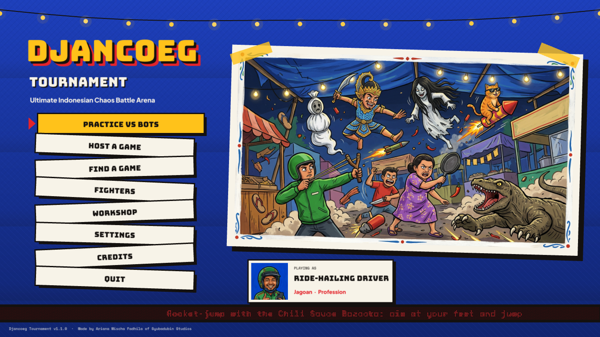
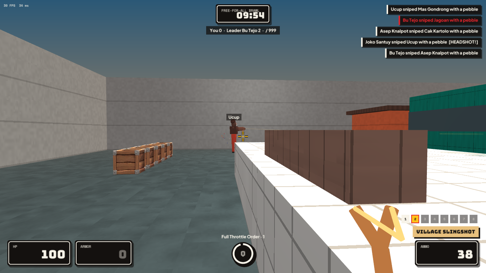
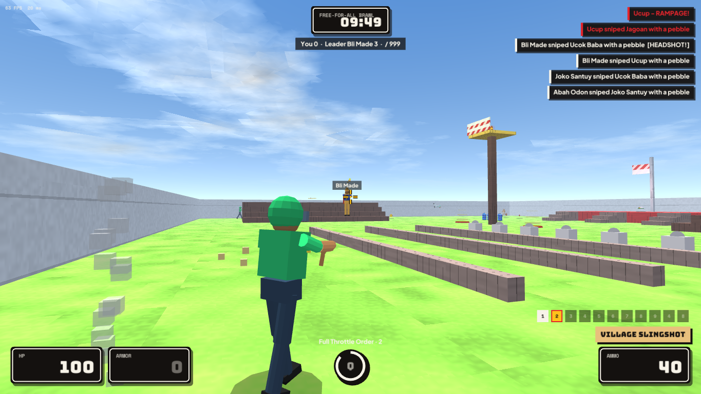
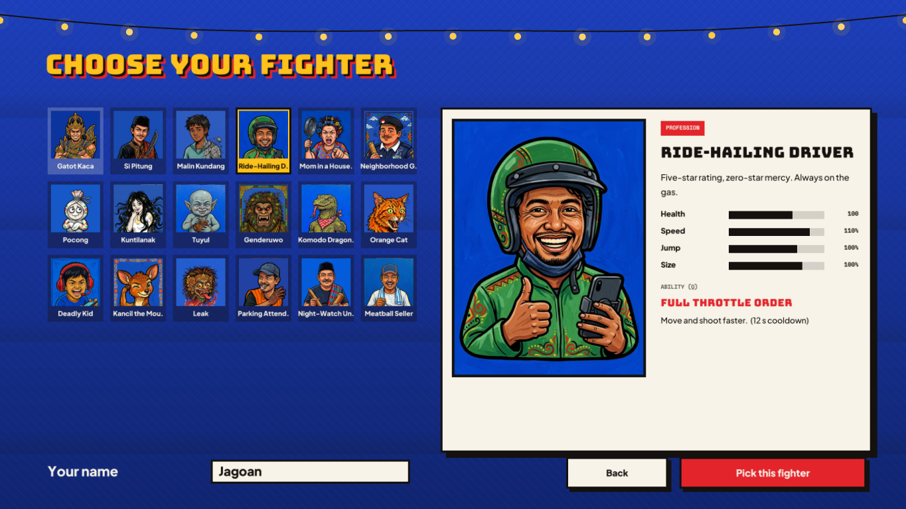
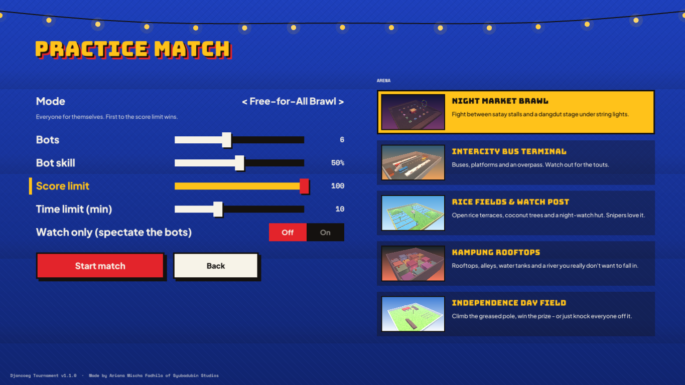
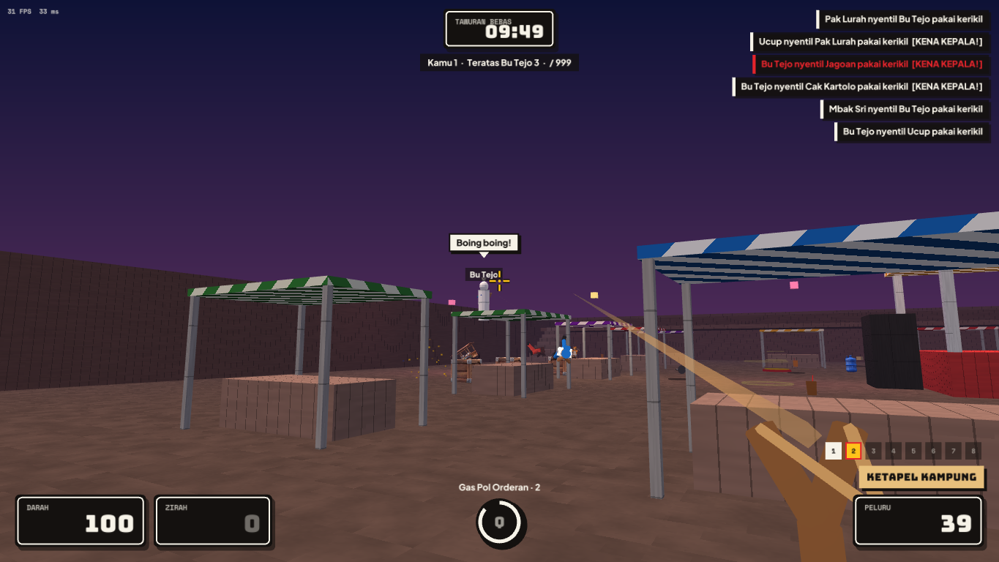
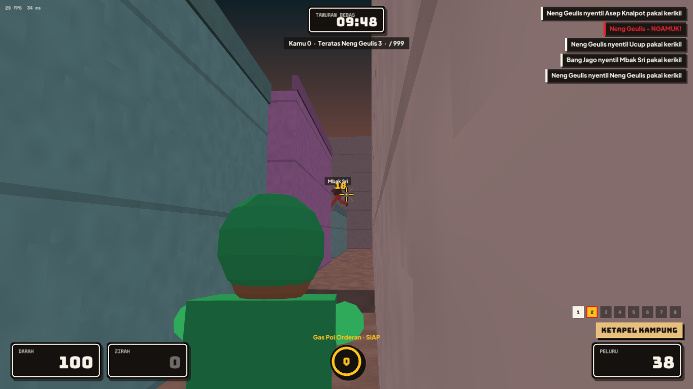
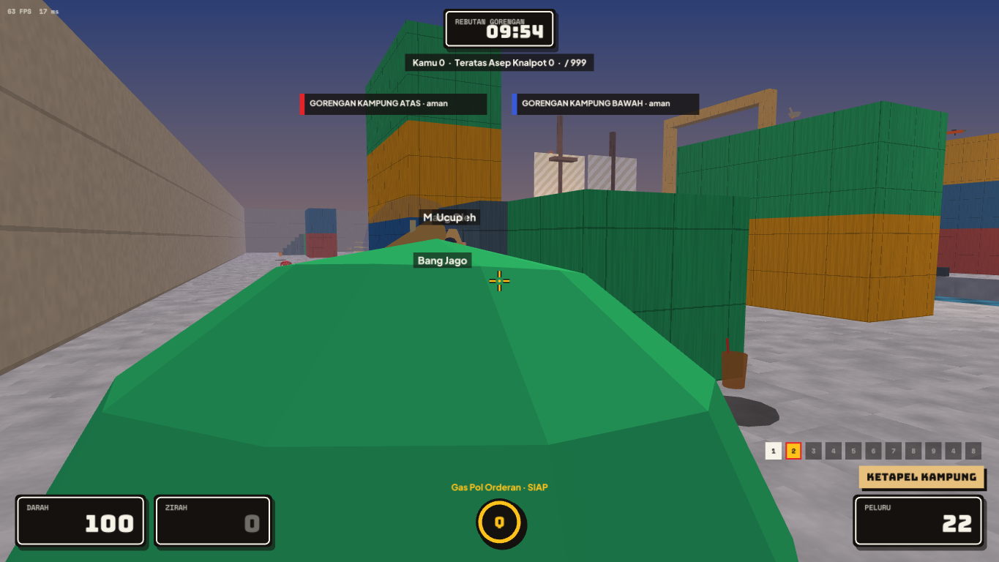
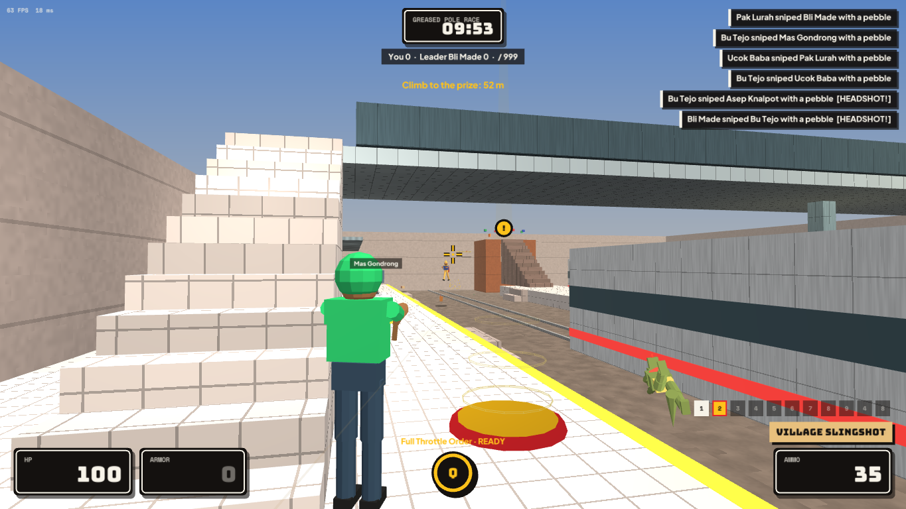

# Djancoeg Tournament

**Ultimate Indonesian Chaos Battle Arena** — a first- and third-person multiplayer arena shooter where wayang heroes, ride-hailing drivers, pocong and orange cats settle things at the night market.

> **Dibuat oleh Ariana Mischa Fadhila dari Syubadubin Studios**
> *Made by Ariana Mischa Fadhila of Syubadubin Studios*

[English](#english) · [Bahasa Indonesia](#bahasa-indonesia) · Docs: [EN](docs/en/README.md) / [ID](docs/id/README.md) · [Roadmap](PLAN.md) · [Progress](Progress.md)



---

## English

### What it is

| | |
|---|---|
| **Modes** | Free-for-All Brawl (*Tawuran Bebas*), Village vs Village team deathmatch (*Perang Kampung*), King of the Warung (*Raja Warung*), Snack Snatch capture-the-flag (*Rebutan Gorengan*), Greased Pole Race (*Panjat Pinang*) |
| **Views** | First person and third person — press **V** at any time |
| **Multiplayer** | Practice vs bots, LAN (auto-discovery), online via a master server with NAT punch-through, direct IP, dedicated server, up to 32 players |
| **Online services** | Encrypted connections (ECDH + AES-GCM), server passwords, admin console & rcon, kick/ban, map/mode votes, career stats & leaderboards, online Workshop |
| **Cross platform** | Windows, Linux, macOS (x64 / Apple Silicon) — .NET 10 + raylib |
| **Fighters** | 17 built-in: legends, professions, ghosts, animals and memes, each with a signature ability |
| **Arenas** | Night Market, Bus Terminal, Rice Fields & Watch Post, Kampung Rooftops, Harbour, Old Train Station, Village Office |
| **Weapons** | 10, from a mosquito racket to a satay fan that blows rockets back at their owner |
| **Chaos** | Knockback and rocket jumps, kickable carts and water jugs that hurt, jump pads |
| **Arena Creeps** | 8 absurd monsters crash matches at random — wedding zombies, a giant floating head, Buto Ijo, a burrowing giant worm and more (toggle in Settings) |
| **Effects** | Blood splats or confetti (your choice), bullet holes, smoke, layered explosions with shockwaves and debris |
| **Modding** | Data-driven fighters, weapons and arenas in JSON; `.djmod` packages; in-game Workshop |
| **Controls** | Rebindable keys, full gamepad support, per-weapon crosshairs, surface footsteps |
| **Spectating** | Kill cam, spectator follow and free cameras (*Watch* in the browser) |
| **Accessibility** | Colour-blind team colours, subtitles, reduced shake/flashes, render scale for slow GPUs |
| **Languages** | English and Bahasa Indonesia, switchable in Settings |

| First person | Third person |
|---|---|
|  |  |





### Quick start

Requirements: [.NET 10 SDK](https://dotnet.microsoft.com/download) and a GPU with OpenGL 3.3.

```bash
dotnet build                                   # build everything
dotnet test                                    # run the test suite
dotnet run --project src/Djancoeg.Client       # play
dotnet run --project src/Djancoeg.Server -- --bots 6 --arena pasar-malam   # dedicated server
```

Then choose **Practice vs bots**, pick your fighter and press **Start match**.

**Controls (rebindable, gamepad supported):** WASD move · Space jump · Ctrl crouch · Left mouse fire · Q / right mouse ability · 1-7, E or wheel weapons · V first/third person · T taunt · Tab scores · Y chat · Esc menu.

### Documentation

| Guide | |
|---|---|
| [Getting started](docs/en/getting-started.md) | Install, build, run, command-line options |
| [Gameplay](docs/en/gameplay.md) | Fighters, weapons, pickups, arenas, modes |
| [Multiplayer & servers](docs/en/multiplayer.md) | Hosting, LAN, online master server, dedicated server, ports |
| [Modding](docs/en/modding.md) | Make fighters, weapons and arenas; package and share `.djmod` |
| [Architecture](docs/en/architecture.md) | Projects, simulation, netcode, performance and memory |
| [Art pipeline](docs/en/assets.md) | Blender sculpt/rig/animate, Rodin 3D & 2D art, screenshots |

### Project layout

```
src/Djancoeg.Core      Simulation: movement, combat, bots, rules, content (no rendering, no allocation per tick)
src/Djancoeg.Net       UDP protocol, server, client prediction/interpolation, LAN discovery, master server
src/Djancoeg.Modding   Mod loading, validation, packaging (.djmod)
src/Djancoeg.Server    Dedicated server, master server and mod tools (djancoeg-server)
src/Djancoeg.Client    The game (raylib): renderer, UI, audio, HUD
tests/Djancoeg.Tests   xUnit tests: physics, combat, arenas, bots, protocol, loopback networking, mods
mods/warung-bakso      Example mod: a meatball seller, a bowl launcher and the Independence Day field
assets/                Fonts, Rodin art, Blender-built fighters, props, voice lines
tools/blender          Reproducible character sculpt + rig + animation script
```

---

## Bahasa Indonesia

### Apa ini

| | |
|---|---|
| **Mode** | Tawuran Bebas, Perang Kampung (tim), Raja Warung (kuasai zona), Rebutan Gorengan (capture the flag), Panjat Pinang (balapan ke puncak) |
| **Kamera** | Orang pertama dan orang ketiga — tekan **V** kapan saja |
| **Multiplayer** | Latihan lawan bot, LAN (terdeteksi otomatis), online lewat master server dengan NAT punch-through, IP langsung, dedicated server, sampai 32 pemain |
| **Layanan online** | Koneksi terenkripsi (ECDH + AES-GCM), password server, konsol admin & rcon, kick/ban, voting arena/mode, statistik karier & papan peringkat, Workshop online |
| **Lintas platform** | Windows, Linux, macOS (x64 / Apple Silicon) — .NET 10 + raylib |
| **Jagoan** | 17 bawaan: legenda, profesi, hantu, hewan, dan meme, masing-masing punya jurus |
| **Arena** | Pasar Malam Ceria, Terminal Antar Kota, Sawah & Pos Ronda, Atap Kampung, Pelabuhan, Stasiun Kereta Tua, Kantor Kelurahan |
| **Senjata** | 10, dari raket nyamuk sampai kipas sate yang memantulkan roket ke pemiliknya |
| **Kekacauan** | Knockback dan rocket jump, gerobak dan galon yang bisa ditendang (dan menyakitkan), kasur lompat |
| **Makhluk Arena** | 8 monster absurd menyerbu secara acak — zombie kondangan, kepala raksasa melayang, Buto Ijo, cacing raksasa dan lainnya (bisa dimatikan) |
| **Efek** | Darah atau konfeti (pilih sendiri), lubang peluru, asap, ledakan berlapis dengan gelombang kejut dan puing |
| **Modding** | Jagoan, senjata, dan arena berbasis JSON; paket `.djmod`; Workshop di dalam game |
| **Kontrol** | Tombol bisa diatur ulang, dukungan gamepad penuh, crosshair per senjata, suara langkah sesuai permukaan |
| **Menonton** | Kill cam, kamera penonton ikuti dan bebas (*Tonton* di pencari server) |
| **Aksesibilitas** | Warna tim ramah buta warna, subtitle, kurangi guncangan/kilatan, skala render untuk GPU lambat |
| **Bahasa** | Inggris dan Bahasa Indonesia, bisa diganti di Pengaturan |


| Orang pertama | Orang ketiga |
|---|---|
|  |  |
|  |  |

### Mulai cepat

Butuh [.NET 10 SDK](https://dotnet.microsoft.com/download) dan GPU dengan OpenGL 3.3.

```bash
dotnet build                                   # build semua proyek
dotnet test                                    # jalankan semua tes
dotnet run --project src/Djancoeg.Client       # main
dotnet run --project src/Djancoeg.Server -- --bots 6 --arena pasar-malam   # dedicated server
```

Pilih **Latihan lawan bot**, pilih jagoanmu, lalu tekan **Gas, mulai!**

**Kontrol (bisa diatur ulang, mendukung gamepad):** WASD jalan · Spasi lompat · Ctrl jongkok · Klik kiri tembak · Q / klik kanan jurus · 1-7, E, atau scroll ganti senjata · V kamera 1/3 · T ejek · Tab skor · Y chat · Esc menu.

### Dokumentasi

| Panduan | |
|---|---|
| [Memulai](docs/id/memulai.md) | Instalasi, build, menjalankan, opsi baris perintah |
| [Gameplay](docs/id/gameplay.md) | Jagoan, senjata, item, arena, mode |
| [Multiplayer & server](docs/id/multiplayer.md) | Buka server, LAN, master server online, dedicated server, port |
| [Modding](docs/id/modding.md) | Bikin jagoan, senjata, dan arena; paketkan dan bagikan `.djmod` |
| [Arsitektur](docs/id/arsitektur.md) | Proyek, simulasi, netcode, performa, dan memori |
| [Pipeline aset](docs/id/aset.md) | Sculpt/rig/animasi Blender, aset 3D & 2D Rodin, screenshot |

---

## Credits / Kredit

**Ariana Mischa Fadhila — Syubadubin Studios.**
Built with .NET 10 and [raylib](https://www.raylib.com/) via Raylib-cs. Fighters sculpted, rigged and animated in Blender (via Blender MCP); 2D art, props and voice lines generated with Rodin. Fonts: Bungee, Plus Jakarta Sans, Space Mono (SIL Open Font License, see `assets/fonts`).

Djancoeg Tournament is a comedy game. Characters are folk legends, generic professions, ghosts from Indonesian folklore, animals and memes — no real people or brands.
