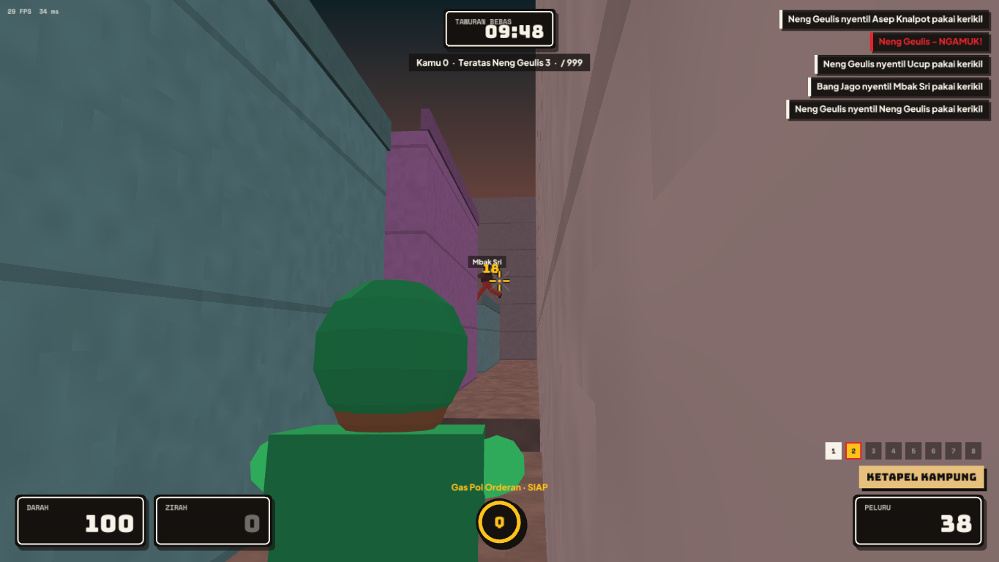

# Djancoeg Tournament documentation (English)

*Made by Ariana Mischa Fadhila of Syubadubin Studios.* · [Bahasa Indonesia](../id/README.md)

1. [Getting started](getting-started.md) — install, build, run, command-line options, troubleshooting
2. [Gameplay](gameplay.md) — controls, fighters, abilities, weapons, pickups, arenas, modes
3. [Multiplayer & servers](multiplayer.md) — practice, hosting, LAN, online, dedicated and master servers
4. [Modding](modding.md) — the mod format, adding fighters/weapons/arenas, packaging and the Workshop
5. [Architecture](architecture.md) — how the code fits together, netcode, performance and memory
6. [Art pipeline](assets.md) — Blender characters, Rodin art, regenerating screenshots
7. [Campaign, editor & achievements](campaign-and-editor.md) — Tur Nusantara, level editor, destruction, achievements, distribution

