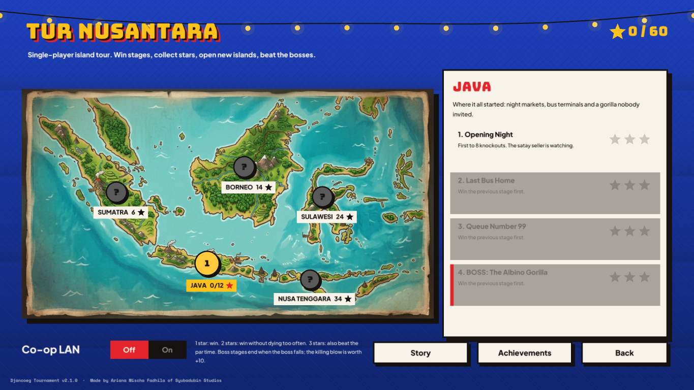
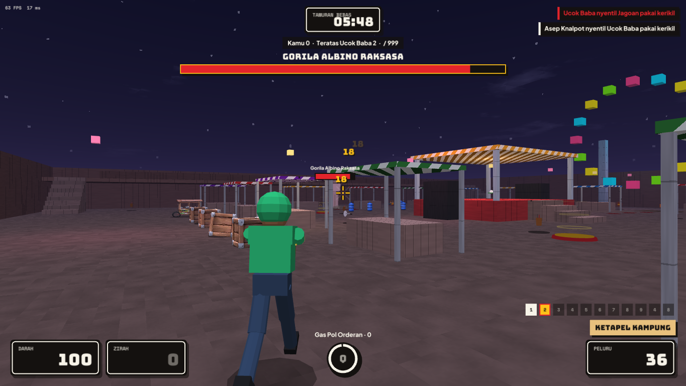
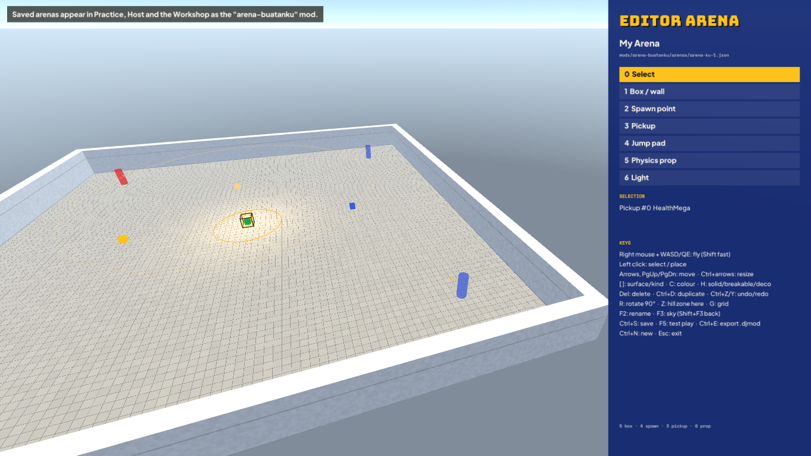
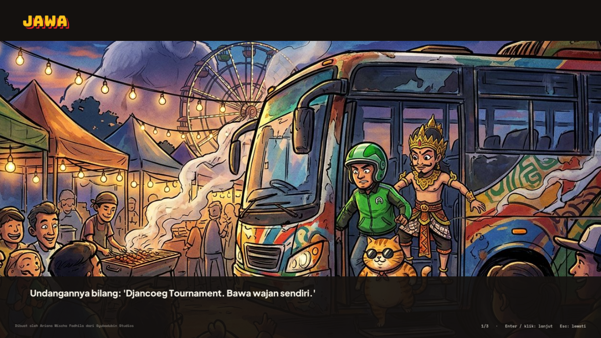
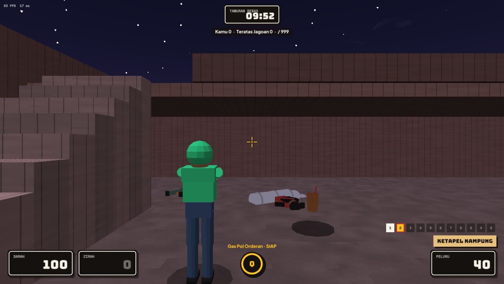
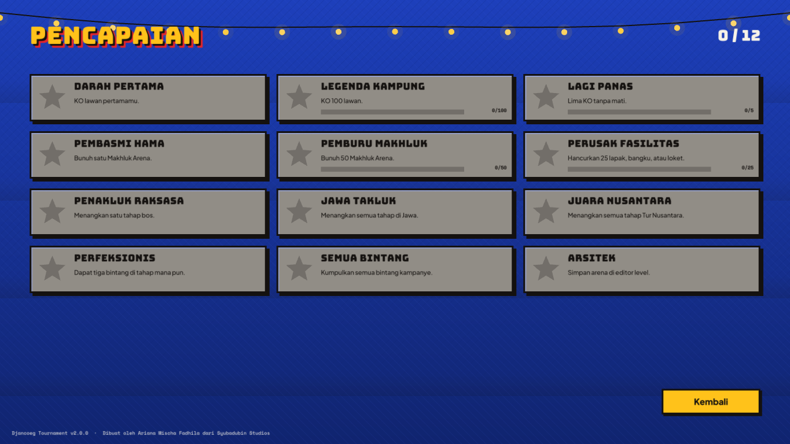

# Tur Nusantara, level editor & achievements

*Made by Ariana Mischa Fadhila of Syubadubin Studios.* · [Bahasa Indonesia](../id/kampanye-dan-editor.md)

Version 2.0 "Nusantara Raya" adds a single-player campaign, an in-game level editor, local achievements, destructible stalls and physics corpses.

## Tur Nusantara (campaign)

Choose **Tur Nusantara (campaign)** at the top of the main menu.

- **Five islands, four stages each.** Java → Sumatra → Borneo → Sulawesi → Nusa Tenggara (bonus tour, 34 stars, two bosses: the Lanky One and the Giant Earthworm). Every stage is a real match against bots on one of the arenas, in any of the five modes.
- **Stars.**
  - ★ Win the stage.
  - ★★ Win with no more deaths than the stage allows.
  - ★★★ Do that and also finish inside the par time.

  The best result is kept.
- **Unlocking.**
  - A stage opens once the one before it has at least one star.
  - An island opens when your total stars reach its requirement: Sumatra 6, Borneo 14, Sulawesi 24.
- **Bosses.** The last stage of each island is a boss fight:

  | Island | Boss |
  |---|---|
  | Java | Albino Gorilla |
  | Sumatra | Cyclops |
  | Borneo | Giant Floating Head |
  | Sulawesi | Buto Ijo |

  - The boss is an Arena Creep with 5–6× health and a health bar at the top of the screen.
  - It comes back if it wanders off, burrows away or falls, keeping the damage you already did.
  - The killing blow is worth **+10 points**. The match ends when the boss falls, and the leader wins.
- **Progress** is saved to `campaign.json` in your app-data folder (`%APPDATA%/DjancoegTournament` on Windows, `~/.config/DjancoegTournament` on Linux/macOS).

Stages are defined in code (`src/Djancoeg.Core/Content/Campaign.cs`). Each `CampaignStage` turns into ordinary `MatchSettings`; boss stages set `BossCreepId` and `BossHealthScale`. Dedicated servers can use the same fields.

## Level editor

Choose **Level editor** in the main menu. It opens the arena you last saved, or a new starter arena with a floor, walls, four spawns and a few pickups.

| Action | Keys |
|---|---|
| Fly | Hold right mouse + WASD, Q/E down/up, Shift faster |
| Tools | `0` select · `1` box/wall · `2` spawn · `3` pickup · `4` jump pad · `5` physics prop · `6` light (or click them in the panel) |
| Select / place | Left click (placing snaps to the grid and lands on the surface under the cursor) |
| Move | Arrow keys (relative to the camera) · PgUp/PgDn up/down |
| Resize | Ctrl + arrows / PgUp/PgDn (boxes, jump pads; lights change radius) |
| Style | `[` `]` surface / pickup kind / spawn team / prop kind / pad strength · `C` colour |
| Box type | `H` cycles solid → **breakable** (120 HP) → decoration |
| Edit | Del delete · Ctrl+D duplicate · Ctrl+Z / Ctrl+Y undo / redo |
| Other | `R` rotate 90° · `Z` King-of-the-Warung zone here · `G` grid 0.25/0.5/1 · `F2` rename · `F3` sky preset (midday, sunset, night, overcast) |
| File | Ctrl+S save · **F5 test play** against 3 bots · Ctrl+E export a shareable `.djmod` · Ctrl+N new · Esc exit |

- **Saving.** Arenas are saved as a normal mod in `mods/arena-buatanku/` (`mod.json` plus `arenas/<id>.json`). They show up in Practice, Host and the Workshop, can be packed into `.djmod` and shared like any other mod.
- **Validation.** The editor won't save an arena that the mod validator would reject (for example, fewer than 2 spawns). It shows the reason instead.
- **Test play.** **F5** saves, reloads content and starts a practice match. **Leave match** returns you to the editor.

The editing logic (`ArenaEditor` in `src/Djancoeg.Modding`) has no window code, so it is unit-tested: placement, snapping, undo/redo, picking and saving.

## Destructible stalls & physics corpses

- **Breakable boxes.** Arena boxes with `"health": <hp>` can be destroyed. Bullets, melee, projectiles and explosions all damage them.
  - Built-in breakables: night-market stall tables and canopies, terminal benches, rooftop water tanks, and the village-office counters and desks.
  - A broken box disappears, stops blocking movement and shots, and bursts into splinters and dust.
  - It breaks into big chunks that tumble and lie on the ground until the box comes back after 45 seconds (unless someone is standing in it).
- **Physics corpses.** Fighters and creeps leave a physics corpse that is thrown by the hit, bounces off the world, splats blood (or confetti) and settles before fading.

## v2.2 additions

### Story stills

Every island opens with an illustrated still and three caption lines the first time you play it. Winning the final boss (Giant Earthworm, Nusa Tenggara) plays the finale. Press Enter or click to continue, and Esc to skip. Replay an island's story with **Story** on the map. The images are in `assets/ui/cutscenes/` and the captions in `Campaign.cs`.

### Co-op over LAN

Switch on **Co-op LAN** at the bottom of the campaign map, then pick a stage.

- **Hosting:** you host the stage as a LAN server on your usual host port. Friends join it from **Find a game**.
- **Teams:** all humans play together on one team against the bots.
  - Free-for-all stages become humans vs bots with a doubled score limit.
  - In King of the Warung and race stages, any human winning clears the stage.
  - Bosses get 50% more health.
- **Progress:** stars and progress are recorded for the host.

### Level editor 2

| Action | How |
|---|---|
| Move with gizmo | Drag the red/green/blue arrows on the selection (each drag is one undo step) |
| Resize with gizmo | Ctrl + drag an arrow |
| Copy / paste | Ctrl+C, then Ctrl+V at the cursor. The clipboard survives switching arenas, so you can copy between arenas |
| Open other arenas | F6 / Shift+F6 cycles your saved arenas, then editable copies of every built-in and mod arena |

### Partial destruction & ragdolls

- **Breakable pieces:** long breakable boxes are cut into up to 4 pieces (about 1.1 m each) when an arena loads. A stall table loses one end at a time, and each piece breaks into chunks and respawns on its own.
  - Up to 128 pieces per arena are replicated (protocol v7).
  - In the editor you still work with whole boxes.
- **Ragdolls:** fighters fall as per-limb ragdolls. The joints are physics points with a rigid torso and floppy head, arms and legs, and they collide with the arena. Creeps keep the simpler rigid corpse.

## Achievements

There are 12 local achievements, unlocked by things like your first knockout, killing creeps, breaking stalls, clearing islands, collecting stars and saving an arena. A toast pops up when one unlocks. Open the list with **Achievements** on the campaign map.

Progress is saved to `achievements.json` in your app-data folder. `distribution/steam/achievements.json` maps each id to a Steamworks API name.

## Distribution

See [`distribution/README.md`](../../distribution/README.md).

- GitHub Actions builds and tests every push and pull request.
- Tags `v*` publish zips for Windows, Linux and macOS to a GitHub Release, and push to itch.io with butler when the `BUTLER_API_KEY` secret is set.
- Steamworks ContentBuilder templates (`app_build.vdf`, `depot_build_*.vdf`) are ready to fill in.
