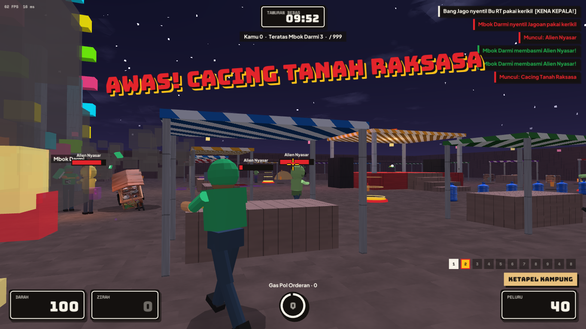

## Arena Creeps

Every few minutes something absurd crashes the match — at a random time and a random place. Creeps chase whoever is nearest (or whoever shot them), can be killed by anyone, and leave on their own after a while. A siren, a big warning and a voice line announce each one.

| Creep | Behaviour | Reward |
|---|---|---|
| Wedding-Party Zombies (*Rombongan Zombie Kondangan*) | A slow horde of six in batik shirts, moaning for leftover rice | 1 each |
| Giant Floating Head (*Kepala Raksasa Melayang*) | Flies over walls, bites from above | 2 |
| The Lanky One (*Si Jangkung*) | Very tall, very fast, long reach that flicks you away | 2 |
| Lost Aliens (*Alien Nyasar*) | Three hopping aliens asking if this is Bekasi | 1 each |
| Giant Albino Gorilla (*Gorila Albino Raksasa*) | Tanky, huge knockback | 2 |
| Buto Ijo | The green giant of Javanese folklore; 900 HP, ground-shaking stomps | 3 |
| Buff Cyclops (*Cyclops Kekar*) | Big, heavy, one giant eye | 2 |
| Giant Earthworm (*Cacing Tanah Raksasa*) | Tunnels under a player (the ground rumbles — run!) and erupts three times | 3 |

Rewards are score points in Free-for-All. Bots shoot creeps when no player is in sight. Creeps are **on by default**; turn them off in *Settings → General → Arena Creeps*, per match in the setup screen, or on a dedicated server with `--no-creeps`.

## Effects

Hits spray blood that splats on floors and walls, deaths burst into gore (gibs for big hits), hitscan shots leave bullet holes and dust, guns puff smoke, and explosions add a smoke column, a shockwave ring, bouncing debris and scorch marks. Prefer it cartoony? Turn off *Settings → Accessibility → Blood effects* to get the original confetti instead.
