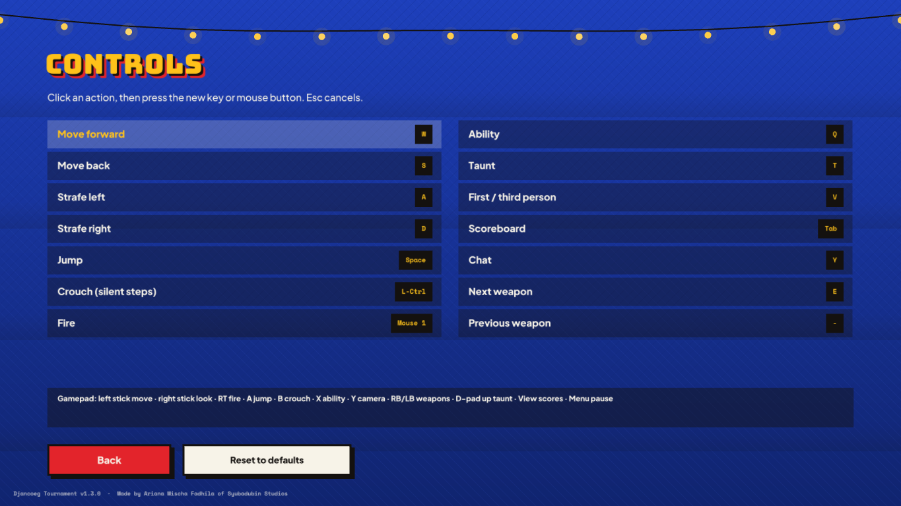

# Gameplay

*Made by Ariana Mischa Fadhila of Syubadubin Studios.*

## Controls

| Key | Action |
|---|---|
| W A S D | Move (Quake-style: bunny-hopping keeps your speed) |
| Space | Jump (hold to hop) |
| Ctrl / C | Crouch |
| Left mouse | Fire |
| Q / right mouse | Ability (*jurus*) |
| 1–7, mouse wheel | Switch weapon |
| V | First / third person |
| T | Taunt (speech bubble) |
| Tab | Scoreboard |
| Y | Chat |
| Esc | Pause menu (change fighter, camera, server leaderboard, settings, leave) |
| F1 / F2 | Vote yes / no when a vote is running |

Every action except the weapon number keys can be **rebound** in *Settings → Controls* (click an action, press the new key or mouse button). Arrow keys, C (crouch), right mouse (ability) and the mouse wheel always work as alternates.

**Gamepad** (XInput layout): left stick move · right stick look · RT fire · A jump · B crouch · X ability · Y camera · RB/LB weapons · D-pad up taunt · View scoreboard · Menu pause. Menus work with the D-pad, A (confirm) and B (back).

## Crosshairs and sounds

The crosshair changes with the weapon: a circle for the racket, a ring matching the real pellet spread for the Wok Shotgun, long side ticks for the piercing Bamboo Spear, drop marks for arcing projectiles and a splash ring for explosives. Headshots have their own bright *tink*. Footsteps depend on the surface (planks, metal, tiles, grass, water, tarp) — **crouch to move silently**.

## The HUD

The vitals are painted like Indonesian license plates: **HP** (*Darah*) and **Armor** (*Zirah*) bottom-left, **Ammo** (*Peluru*) bottom-right with the current weapon's name tag and the slot strip above it. The ring in the middle is your ability cooldown; it turns yellow and says **READY** (*SIAP*) when it can be used. The match clock and the score line sit at the top, and the kill feed on the right tells you who *nyentil* whom.

## Fighters

| Fighter | Category | HP | Speed | Ability |
|---|---|---|---|---|
| Gatot Kaca | Legend | 110 | 100% | **Copper Muscles** — super jump |
| Si Pitung | Legend | 100 | 105% | **Lightning Machete** — dash |
| Malin Kundang | Legend | 120 | 95% | **Mother's Curse** — stone skin (35% damage taken, 5 s) |
| Ride-Hailing Driver (*Tukang Ojol*) | Profession | 100 | 110% | **Full Throttle Order** — haste (×1.5 move, faster fire) |
| Mom in a Housedress (*Emak-Emak Daster*) | Profession | 115 | 100% | **Mom's Lecture** — shockwave knockback |
| Neighborhood Guard (*Satpam Komplek*) | Profession | 110 | 100% | **Night-Watch Coffee** — instant heal |
| Pocong | Ghost | 100 | 100% (jump 125%) | **Pocong Hop** — giant hop |
| Kuntilanak | Ghost | 90 | 105% | **Vanishing Giggle** — invisibility until you shoot |
| Tuyul | Ghost | 75 | 120%, small | **Pickpocket Sprint** — haste |
| Genderuwo | Ghost | 150 | 85%, big | **Forest Roar** — big shockwave |
| Komodo Dragon | Animal | 130 | 95% | **Dragon Lunge** — dash that bites whoever it hits |
| Orange Cat (*Kucing Oren*) | Animal | 85 | 115%, small | **Feral Mode** — haste |
| Deadly Kid (*Bocil Kematian*) | Meme | 80 | 112%, small | **Mic Spam** — shockwave |
| Kancil the Mouse-Deer (*Si Kancil*) | Legend | 80 | 115%, small | **Clever Leap** — teleport up to 9 m where you look |
| Leak | Ghost | 95 | 100% | **Night Flight** — float for 5 s, hold jump to rise |
| Parking Attendant (*Tukang Parkir*) | Profession | 105 | 100% | **Back It Up!** — whistle that pulls everyone nearby towards you |
| Night-Watch Uncle (*Bapak-Bapak Ronda*) | Meme | 125 | 95%, big | **Danger Drum** — heal 30 and speed up yourself and nearby teammates |

Size matters: small fighters are harder to hit and big ones get pushed around less. The example mod adds **Abang Bakso** (meatball seller, *Runaway Cart* dash).

## Weapons

| Slot | Weapon | Type | Notes |
|---|---|---|---|
| 1 | Electric Mosquito Racket | Melee | Always available, 45 damage, big knockback |
| 2 | Village Slingshot | Hitscan | Starting weapon, accurate, headshots ×1.5 |
| 3 | Wok Shotgun | Hitscan ×9 pellets | Devastating up close |
| 4 | Flip-Flop Gatling | Projectile | Rapid sandals, lead your target |
| 5 | Bouncing Firecracker | Projectile, bounces | Splash damage, great around corners |
| 6 | Chili Sauce Bazooka | Rocket | Big splash; shoot your feet while jumping to **rocket-jump** |
| 7 | Sacred Bamboo Spear | Hitscan, piercing | Goes through everyone in a line |
| 8 | Thrown Stone Mortar (*Cobek Lempar*) | Heavy lob | 95 damage on a direct hit, high arc |
| 9 | Satay Fan (*Kipas Sate*) | Wind cone | Shoves players and props off ledges and **turns enemy projectiles around** |
| 4 | Cracker Shuriken (*Kerupuk Shuriken*) | 3 fast projectiles | Shares slot 4 with the Gatling — press 4 again to switch |

Weapons that share a number key cycle when you press it again.

Self-inflicted splash damage is halved, but the knockback is full — that is how rocket jumps work.

## Pickups

| Pickup | Effect |
|---|---|
| Sweet iced tea (*Es Teh*) | +25 HP (up to max) |
| Nasi Padang | +100 HP, can overheal to 200 (decays slowly) |
| SNI Helmet (*Helm SNI*) | +50 armor (armor absorbs ⅔ of damage) |
| Safety vest (*Rompi*) | +15 armor |
| Ammo box (*Kardus amunisi*) | Ammo for every weapon you own |
| Jamu | ×3 damage for 15 s — the holder glows red |
| Weapon | The weapon plus ammo |

## Chaos physics

- **Knockback** from every hit; explosions launch players and props.
- **Props** (carts, water jugs, crates, sacks, tyres) can be kicked, shot and blown up. A prop flying faster than ~9 m/s hurts whoever it hits — the kill is credited to whoever touched it last.
- **Jump pads** (*kasur lompat*) throw you to walkways, roofs and the stage canopy.
- **Rivers and voids**: falling out of the arena kills you; whoever hit you in the last 5 seconds gets the point.

## Arenas

| Arena | Look | Highlights |
|---|---|---|
| Night Market (*Pasar Malam Ceria*) | Night, string lights | Dangdut stage with canopy, walkable stall roofs, raised walkways, ferris wheel |
| Intercity Bus Terminal (*Terminal Antar Kota*) | Golden hour | Overpass, platforms, bus roofs reached by pads |
| Rice Fields & Watch Post (*Sawah & Pos Ronda*) | Bright day | Open paddies, terraced hills, watch-post hut — sniper heaven |
| Kampung Rooftops (*Atap Kampung*) | Sunset | Rooftops of different heights, alleys, a river you can fall into |
| Harbour (*Pelabuhan Sunda Kelapa*) | Dawn | Container stacks, a pinisi schooner with a crow's nest, a channel you can fall into |
| Old Train Station (*Stasiun Kereta Tua*) | Afternoon | Carriage roofs, footbridge, clock tower |
| Village Office (*Kantor Kelurahan*) | Noon | Indoor rooms and counters, courtyard with flagpole, walkable roof |
| Independence Day Field (*Lapangan Tujuhbelasan*, mod) | Day | Greased pole with the Jamu on top |

## Modes

| Mode | Rules |
|---|---|
| **Free-for-All Brawl** (*Tawuran Bebas*) | +1 per kill, −1 per suicide. First to the score limit, or highest at the time limit. |
| **Village vs Village** (*Perang Kampung*) | Upper vs Lower Village. Team kills count; friendly fire off by default. |
| **King of the Warung** (*Raja Warung*) | Stand in the zone **alone** to earn 1 point per second. Two people inside = contested. |
| **Snack Snatch** (*Rebutan Gorengan*) | Capture the flag with a giant fried banana. Grab the other village's gorengan and bring it to your plate while yours is at home (team +1, carrier +5). Dropped gorengan return after 20 s or when a defender touches them. |
| **Greased Pole Race** (*Panjat Pinang*) | Race to the prize at the top of the arena (crow's nest, clock tower, office roof…). Touch it to score, then you start again from a spawn. Knock climbers off! |

After a match ends the scoreboard shows the winner for 10 seconds; hosted servers then rotate to the next arena.

## Kill cam and spectating

When you are taken out, the camera rises from your body and looks at whoever got you, showing their remaining HP, until you respawn.

**Spectate** a match with *Watch* in the server browser, or *Watch only* in the practice setup to watch the bots. Fire (or Next weapon) cycles through players, Ability/Previous weapon goes back, and the camera key switches to a **free camera** (movement keys, Jump/Crouch for up/down, Shift for speed). Spectators don't take a player slot (up to 8 per server).

## Graphics and accessibility

| Settings tab | Options |
|---|---|
| Graphics | Effects quality (lights and particle density), 3D render scale (50–100%, great for slow GPUs), field of view, blob shadows, MSAA (restart), fullscreen, FPS/ping |
| Accessibility | Colour-blind team colours (orange/sky blue instead of red/blue and green/red name tags), subtitles for announcer lines, reduce screen shake, reduce flashes |

