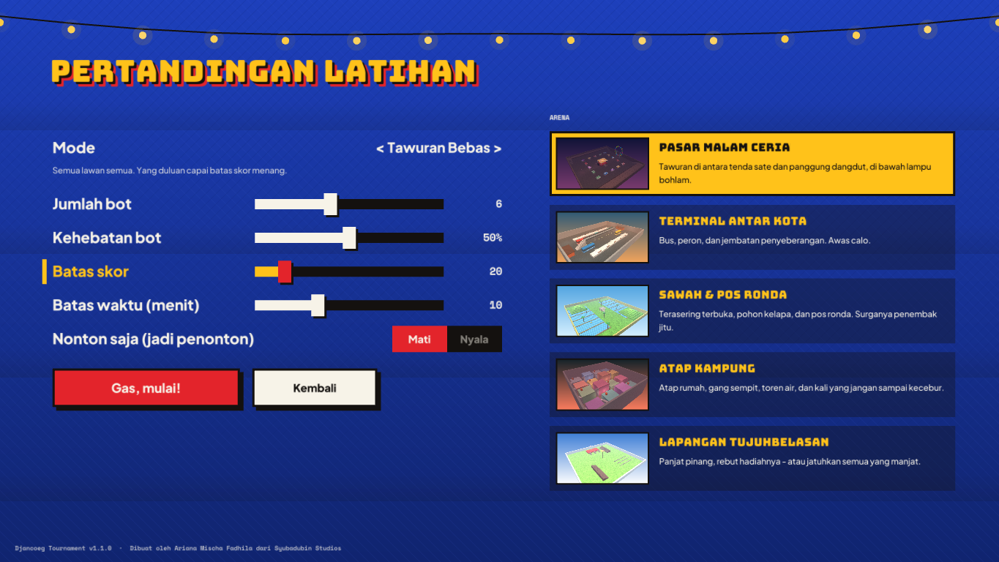

# Getting started

*Made by Ariana Mischa Fadhila of Syubadubin Studios.*

## Requirements

- **.NET 10 SDK** (10.0.100 or newer) — `dotnet --version`
- A GPU and driver with **OpenGL 3.3** (any GPU from the last decade, including integrated graphics)
- Windows 10/11, a modern Linux desktop (X11 or Wayland/XWayland), or macOS 12+

Raylib's native libraries for `win-x64`, `win-x86`, `linux-x64`, `osx-x64` and `osx-arm64` come with the Raylib-cs NuGet package, so there is nothing else to install.

## Build, test, run

```bash
git clone <repo> && cd DjancoegTournament
dotnet build                    # builds all 6 projects
dotnet test                     # 105 tests: physics, combat, arenas, bots, networking, mods
dotnet run --project src/Djancoeg.Client
```

For the smoothest frame rate, play a Release build:

```bash
dotnet run --project src/Djancoeg.Client -c Release
```

Run a single test, or a group of tests:

```bash
dotnet test --filter "FullyQualifiedName~MovementTests.Player_climbs_stairs"
dotnet test --filter "FullyQualifiedName~LoopbackTests"
```

## First match

1. **Fighters** (*Pilih jagoan*) — pick a fighter and type your name.
2. **Practice vs bots** (*Latihan lawan bot*) — choose an arena, a mode, the number of bots and their skill.
3. **Start match** (*Gas, mulai!*). Press **Esc** for the pause menu and **Tab** for the scoreboard.



## Client command line

| Option | Meaning |
|---|---|
| `--connect host:port` | Join a server directly on start-up |
| `--lang en` / `--lang id` | Override the interface language |
| `--size 1600x900` | Requested window size (shrinks to fit the monitor) |
| `--novsync` | Disable VSync (benchmarking) |
| `--shot <scene> --out file.png [--arena id] [--delay s]` | Render one scene and save a screenshot (see [assets.md](assets.md)) |

Settings are stored in `%APPDATA%/DjancoegTournament/settings.json` (Windows) or `~/.config/DjancoegTournament/settings.json` (Linux/macOS).

## Release packages

```powershell
pwsh scripts/publish.ps1                       # all platforms -> artifacts/*.zip
pwsh scripts/publish.ps1 -Runtimes win-x64
```
```bash
scripts/publish.sh linux-x64                   # -> artifacts/*.tar.gz
```

Each package is self-contained (no .NET install needed) and contains both the game (`DjancoegTournament`) and the server (`djancoeg-server`).

## Installers

Release installers are built by `.github/workflows/release.yml` when a `v*` tag is pushed (or on demand from the Actions tab). You can also build them locally:

| Platform | Command | Output (`artifacts/installers/`) |
|---|---|---|
| Windows | `pwsh installer/build-windows.ps1` (needs [Inno Setup 6](https://jrsoftware.org/isinfo.php)) | `DjancoegTournament-Setup-win-x64.exe`, `DjancoegTournament-win-x64-portable.zip` |
| Linux | `installer/linux/build.sh` (needs `dpkg-deb`; downloads `appimagetool`) | `DjancoegTournament-x86_64.AppImage`, `djancoeg-tournament_amd64.deb`, `DjancoegTournament-linux-x64.tar.gz` |
| macOS | `installer/macos/build.sh` (on a Mac) | `DjancoegTournament-macOS-arm64.dmg`, `DjancoegTournament-macOS-x64.dmg` |

Installed builds are read-only, so mods, Workshop downloads and editor arenas go to the user folder (`%APPDATA%/DjancoegTournament/mods`, `~/.config/DjancoegTournament/mods`). The bundled example mods are copied there on first start. Set `DJANCOEG_MODS` to use another folder.

### Signing, Flatpak, package managers and Steam

- **Windows signing:** add the repository secrets `WINDOWS_CERT_PFX_BASE64` (base64 of a code-signing `.pfx`) and `WINDOWS_CERT_PASSWORD`. The release then Authenticode-signs both executables, the portable zip contents and the setup, with an RFC 3161 timestamp. Locally, set the same environment variables before `installer/build-windows.ps1`.
- **macOS signing and notarization:**
  - Add `MACOS_CERT_P12_BASE64` and `MACOS_CERT_PASSWORD` (a *Developer ID Application* certificate). The app is then signed with the hardened runtime (`installer/macos/entitlements.plist`).
  - Also add `APPLE_ID`, `APPLE_TEAM_ID` and `APPLE_APP_PASSWORD` (an app-specific password) to notarize and staple the .dmg.
  - Without these secrets builds stay ad-hoc signed.
- **Flatpak:** `installer/linux/build-flatpak.sh` (after `installer/linux/build.sh`) builds `DjancoegTournament-x86_64.flatpak` with the Freedesktop 24.08 runtime, using app id `com.syubadubin.DjancoegTournament` and the manifest and metainfo in `installer/linux/flatpak/`.
- **winget / Homebrew:** each release attaches `package-manifests.zip`. It contains winget manifests (`SyubadubinStudios.DjancoegTournament`) and a Homebrew cask (`djancoeg-tournament`) with the release's URLs and SHA-256 hashes. Submitting them is manual: open a PR to `microsoft/winget-pkgs`, and add the cask to your own tap.
- **Steam build (Windows x64):** `dotnet publish src/Djancoeg.Client -c Release -r win-x64 --self-contained -p:Steam=true`.
  - This adds Facepunch.Steamworks and `steam_api64.dll`.
  - Achievements are mirrored as `ACH_<id>` (see `distribution/steam/achievements.json`), and the friends list shows rich presence (menu, match, campaign stage, editor).
  - The app id comes from `steam_appid.txt` or `DJANCOEG_STEAM_APPID`. Without Steam running, the game simply runs without it.
  - The default build contains no Steam code.

## Troubleshooting

| Problem | Fix |
|---|---|
| Black window or crash on start | Update your GPU driver; the game needs OpenGL 3.3. On Linux VMs, enable 3D acceleration. |
| "Content mismatch" when joining | The server runs different mods. Enable the same mods in the Workshop (the message lists them). |
| Nobody can join my hosted game | Allow UDP port 27960 in your firewall; for internet play forward UDP 27960 on your router. |
| No sound | Check the volume sliders in Settings; on Linux make sure PulseAudio/PipeWire is running. |
| Mouse is stuck to the window | Press **Esc** to open the pause menu, which releases the cursor. |
