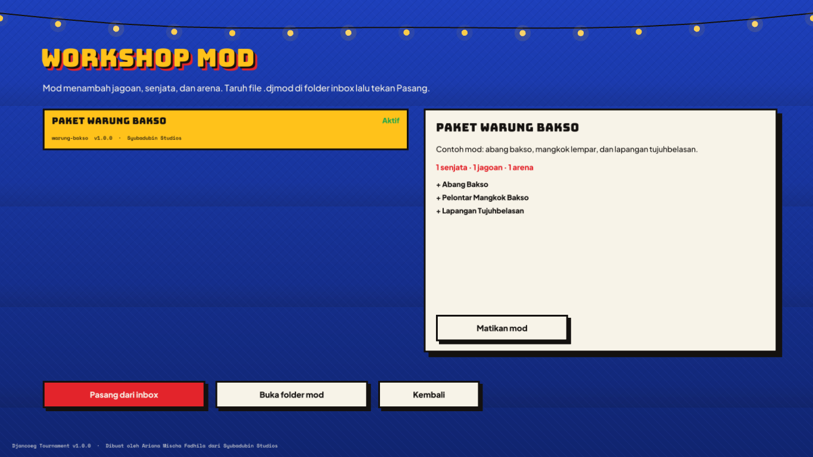

# Modding

*Made by Ariana Mischa Fadhila of Syubadubin Studios.*

Everything a fighter, weapon or arena does is data, so mods need no code — just JSON (and optionally models and pictures).



## Where mods live

```
mods/
  warung-bakso/           <- one folder per mod (folder name = load order)
    mod.json              <- the manifest
    arenas/lapangan-17an.json
  settings.json           <- which mods are disabled (written by the Workshop)
  _inbox/                 <- drop .djmod packages here, then press "Install from inbox"
```

The game loads `mods/` next to the executable. Mods are applied after the built-in content in folder-name order; an item with an existing id **replaces** it (e.g. a mod can rebalance `bazooka-sambal`).

## Tools

```bash
djancoeg-server mod new my-mod                 # scaffold mods/my-mod/mod.json with an example weapon
djancoeg-server mod validate mods/my-mod       # check for mistakes
djancoeg-server mod pack mods/my-mod ./out     # -> out/my-mod-1.0.0.djmod (zip)
djancoeg-server mod install my-mod-1.0.0.djmod # install into ./mods
djancoeg-server mod list
```

(`dotnet run --project src/Djancoeg.Server -- mod ...` from the source tree.)

## The manifest

```json
{
  "id": "warung-bakso",
  "name": { "en": "Meatball Stall Pack", "id": "Paket Warung Bakso" },
  "description": { "en": "…", "id": "…" },
  "author": "Syubadubin Studios",
  "version": "1.0.0",
  "gameVersion": "1.0",
  "weapons": [ … ],
  "characters": [ … ],
  "arenas": [ … ],
  "arenaFiles": ["arenas/lapangan-17an.json"]
}
```

Ids use `a-z`, `0-9` and `-` (2–40 characters). Every text field is a `{ "en": "…", "id": "…" }` pair; if one language is missing the other is shown. Unspecified fields keep their defaults. Comments and trailing commas are allowed.

## Weapons

```json
{
  "id": "mangkok-bakso", "slot": 8, "kind": "Projectile", "model": "firecracker", "color": "#FFCC80",
  "name": { "en": "Meatball Bowl Lobber", "id": "Pelontar Mangkok Bakso" },
  "killVerb": { "en": "{killer} served {victim} a scalding bowl", "id": "{killer} menyiram {victim} pakai kuah bakso panas" },
  "damage": 40, "splashDamage": 45, "splashRadius": 2.8, "knockback": 7, "fireInterval": 0.7,
  "projectileSpeed": 22, "projectileGravity": 14, "projectileLifetime": 3,
  "maxAmmo": 30, "startAmmo": 8, "pickupAmmo": 8
}
```

| Field | Default | Notes |
|---|---|---|
| `kind` | Hitscan | `Melee`, `Hitscan` or `Projectile` |
| `slot` | 1 | Key 1–9 |
| `damage` | 10 | Per pellet / direct hit (0–500) |
| `fireInterval` | 0.5 | Seconds between shots (≥ 0.05) |
| `pellets`, `spreadDegrees` | 1, 0 | Shotgun-style spread |
| `range` | 200 | Hitscan/melee reach in metres |
| `projectileSpeed`, `projectileGravity`, `projectileLifetime`, `projectileBounces` | 30, 0, 5, false | Projectile behaviour |
| `splashRadius`, `splashDamage` | 0, 0 | Explosion on impact or when the lifetime ends |
| `knockback`, `selfDamageScale` | 2, 0.5 | Push force; share of splash damage dealt to yourself |
| `maxAmmo`, `startAmmo`, `pickupAmmo`, `infiniteAmmo` | 100, 25, 10, false | Ammo |
| `piercing` | false | Hitscan goes through everyone in line |
| `startsWith` | false | Every fighter spawns with it |
| `model` | slingshot | `racket`, `slingshot`, `pan`, `sandal`, `firecracker`, `bazooka`, `bamboo` |
| `killVerb` | | Kill-feed sentence with `{killer}` and `{victim}` |

A weapon is obtained by spawning with it (`startsWith`) or from a `Weapon` pickup in an arena.

## Fighters

```json
{
  "id": "abang-bakso", "category": "Profession", "shape": "Humanoid",
  "name": { "en": "Meatball Seller", "id": "Abang Bakso" },
  "description": { "en": "…", "id": "…" },
  "maxHealth": 105, "speedMultiplier": 1.0, "jumpMultiplier": 1.0, "scale": 1.0,
  "primaryColor": "#FFFFFF", "secondaryColor": "#1565C0", "skinColor": "#A0663C",
  "ability": { "kind": "Dash", "cooldown": 7, "power": 1.1, "name": { … }, "description": { … } },
  "taunts": [ { "en": "Meatballs! Hot meatballs!", "id": "Baksooo! Bakso panas!" } ],
  "model": "models/characters/abang-bakso.glb",
  "portrait": "art/portraits/abang-bakso.png"
}
```

| Field | Range | Notes |
|---|---|---|
| `category` | Legend, Profession, Ghost, Animal, Meme | Shown on the fighter card |
| `maxHealth` | 25–300 | |
| `speedMultiplier` | 0.5–1.6 | |
| `jumpMultiplier` | 0.5–2 | |
| `scale` | 0.5–1.6 | Changes the hitbox too |
| `ability.kind` | SuperJump, Dash, Shockwave, Heal, Invisibility, Haste, StoneSkin, None | `power`: jump/dash/shockwave strength, heal amount, haste multiplier, or damage factor for StoneSkin; `duration` for timed abilities |
| `model`, `portrait` | optional | Paths relative to the game's `assets/` folder. Without a model the game draws a coloured capsule; without a portrait, a colour swatch. |

To make a rigged model in the house style, add your fighter to `tools/blender/build_characters.py` (see [assets.md](assets.md)) — the game picks clips named `idle`, `run`, `shoot` and `die`.

## Arenas

Arenas are lists of axis-aligned boxes plus gameplay markers. Coordinates are metres, **Y is up**, players are 1.8 m tall, can step up 0.5 m and jump about 1.2 m.

```json
{
  "id": "lapangan-17an",
  "name": { "en": "Independence Day Field", "id": "Lapangan Tujuhbelasan" },
  "skyTop": "#3A7BD5", "skyBottom": "#FFFFFF", "fogColor": "#D6E9FF", "fogDensity": 0.008,
  "ambientColor": "#9AA9BF", "sunColor": "#FFF8E1", "sunDirection": [-0.3, -0.9, 0.2],
  "killY": -20, "zoneCenter": [0, 9.3, 0], "zoneRadius": 1.6,
  "boxes":    [ { "min": [-30,-1,-30], "max": [30,0,30], "surface": "Grass", "color": "#7CB342" } ],
  "spawns":   [ { "position": [-26,0,-26], "yaw": 0.78, "team": 0 } ],
  "pickups":  [ { "position": [0,9.3,0], "kind": "Quad", "respawnSeconds": 45 },
                { "position": [-15,0,-18], "kind": "Weapon", "weapon": "mangkok-bakso" } ],
  "jumpPads": [ { "min": [-5.8,0,-0.8], "max": [-4.2,0.25,0.8], "launch": [2.92,20.5,0] } ],
  "props":    [ { "kind": "galon", "position": [8,0.5,8], "halfExtents": [0.28,0.5,0.28], "mass": 18, "color": "#4FC3F7" } ],
  "lights":   [ { "position": [0,10,0], "color": "#FFEB3B", "radius": 12 } ]
}
```

| Element | Notes |
|---|---|
| `boxes[].surface` | Ground, Wall, Wood, Metal, Fabric (striped tarp), Water (animated), Grass, Tile, Neon (glows), Roof (corrugated) |
| `boxes[].solid` | `false` for decoration (lamps, flags, clothes) |
| `spawns[].team` | 0, 1, or -1 for any team; `yaw` in radians (0 faces +Z) |
| `pickups[].kind` | HealthSmall, HealthMega, Armor, ArmorSmall, Weapon, Ammo, Quad |
| `jumpPads[].launch` | Velocity in m/s. Gravity is 20 m/s². To land on a point, use `v_y = sqrt(2·20·(apex−y0))`, then horizontal = distance / flight time. |
| `props[].kind` | crate, galon, gerobak, karung, ban (picks the model) |
| `killY` | Falling below this height kills |
| `zoneCenter`, `zoneRadius` | King of the Warung zone |

Limits: 1–4096 boxes, 64 pickups, 64 props, at least 2 spawns. Test with bots: `djancoeg-server --arena my-arena --bots 8` and watch the log, or play it from **Practice**.

## Sharing

1. `djancoeg-server mod validate mods/my-mod`
2. `djancoeg-server mod pack mods/my-mod`
3. Share the `.djmod`. Players put it in `mods/_inbox/` and press **Install from inbox** in the Workshop, or run `djancoeg-server mod install file.djmod`.

Packages are zip files; the installer rejects entries that would write outside the mod folder.
