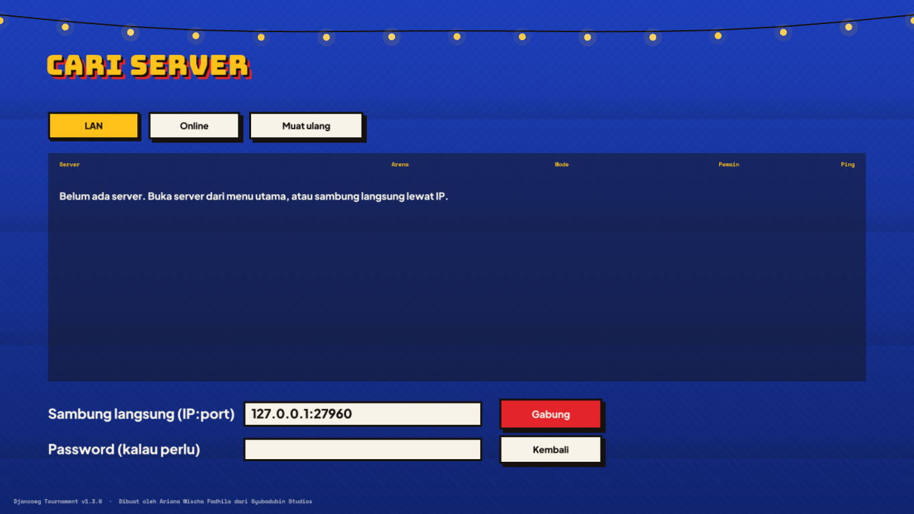

# Multiplayer & servers

*Made by Ariana Mischa Fadhila of Syubadubin Studios.*

Every way of playing uses the same authoritative server code. Practice starts a private server on `127.0.0.1` inside the game; **Host a game** starts it on all network interfaces; the dedicated server runs it without graphics.

## Ways to play

| Menu | What happens |
|---|---|
| Practice vs bots | In-process server bound to loopback, random port. Nobody else can join. |
| Host a game | In-process server on UDP `27960` (configurable). Visible on the LAN; optionally listed on a master server. Arenas rotate after each match. |
| Find a game → LAN | Broadcasts a discovery packet on ports 27960–27963 and lists every server that answers. |
| Find a game → Online | Asks the master server (Settings → *Master server address*) for its list, then pings each server. |
| Direct connect | Type `ip:port` or `hostname:port`. |
| Watch | Join the selected server as a spectator (no player slot, up to 8 per server). |



## Dedicated server

```bash
dotnet run --project src/Djancoeg.Server -c Release -- --name "Warung Tawuran" --arena pasar-malam --mode ffa --bots 6
# or, from a published package:
./djancoeg-server --rotation pelabuhan,stasiun-kereta,kantor-kelurahan --mode ctf --score 3 --score 50 --time 900
```

| Option | Default | Meaning |
|---|---|---|
| `--port` | 27960 | UDP port |
| `--name` | Warung Tawuran | Name in the server browser |
| `--arena` | pasar-malam | First arena (any built-in or mod arena id) |
| `--rotation a,b,c` | — | Arena rotation after each match |
| `--mode` | ffa | `ffa`, `tdm`, `koth`, `ctf` (Rebutan Gorengan) or `race` (Panjat Pinang) |
| `--score` | 25 | Score limit |
| `--time` | 600 | Time limit in seconds (0 = none) |
| `--bots` | 5 | Bots to fill empty slots (removed automatically as people join) |
| `--skill` | 0.5 | Bot skill 0–1 |
| `--max` | 16 | Max players (2–16) |
| `--friendly-fire` | off | Team damage in `tdm` |
| `--master host:port` | — | Advertise to a master server every 20 s |
| `--mods dir` / `--no-mods` | ./mods | Mod folder, or built-in content only |
| `--config file.json` | — | Load the match settings from JSON |
| `--password <text>` | — | Players must enter this password to join |
| `--rcon <text>` | — | Admin password for `!login` in chat |
| `--data <dir>` | ./data | Where `stats.json` (career stats) and `bans.txt` are kept |
| `--no-votes` | votes on | Disable `!vote` |
| `--max` | 16 | Max players, **up to 32** |

Example `--config` file:

```json
{ "Mode": "KingOfTheHill", "ArenaId": "sawah-ronda", "ScoreLimit": 120, "TimeLimitSeconds": 900, "BotCount": 4, "BotSkill": 0.7, "MaxPlayers": 12, "ServerName": "Raja Pos Ronda" }
```

Press **Ctrl+C** to stop; players are notified.

### Running as a service (Linux)

```ini
# /etc/systemd/system/djancoeg.service
[Unit]
Description=Djancoeg Tournament server
After=network-online.target

[Service]
WorkingDirectory=/opt/djancoeg
ExecStart=/opt/djancoeg/djancoeg-server --rotation pasar-malam,terminal-bus,sawah-ronda,atap-kampung --bots 4 --master master.example.org:27950
Restart=on-failure
User=djancoeg

[Install]
WantedBy=multi-user.target
```

## Master server (online server list)

```bash
./djancoeg-server master --port 27950
```

Game servers started with `--master host:27950` send a heartbeat every 20 seconds and are dropped after 60 seconds of silence. Players set *Master server address* in Settings and use **Find a game → Online**.

## Ports and firewalls

| Port | Protocol | Who |
|---|---|---|
| 27960 | UDP | Game server (players connect here; LAN discovery too) |
| 27950 | UDP | Master server (only if you run one) |

For internet hosting forward the game port on your router. Only the server needs open ports; clients just send outbound UDP.

## Mods and multiplayer

The server and every client must load the same content. On connect the client sends a **content signature** (a hash of all weapon, fighter and arena ids plus their key numbers). If it differs, the server refuses the connection and lists the mods it runs. The browser marks such servers *different mods*.

## Netcode in one paragraph

The server simulates at **60 Hz** and sends a snapshot to every client at **30 Hz**. Clients send their input every tick (the last 4 inputs redundantly, so a lost packet costs nothing), **predict** their own movement with the exact same movement code, and **reconcile** when a snapshot arrives by replaying unacknowledged inputs. Other players are **interpolated** 100 ms in the past. Hitscan weapons are **lag compensated**: the server rewinds other players by the shooter's latency + interpolation delay. Events (shots, kills, pickups) ride inside snapshots with acknowledgements, so they are never lost. Details: [architecture.md](architecture.md#networking).

## Security

Every connection starts with a **stateless cookie challenge**: the server answers a first `Connect` with a small `Challenge` cookie (HMAC of the client's address and a timestamp, valid 10 s) and only creates state once the client echoes it. Spoofed addresses never get a slot, and the answer is smaller than the request, so the server can't be used for amplification attacks.

If the server has a password, the client proves it knows it with `HMAC-SHA256(SHA256(password), cookie)`; the password itself never crosses the network.

Both sides then run an **ECDH (P-256)** key exchange and derive two **AES-256-GCM** keys with HKDF (salted with the cookie). Everything after `Accept` — inputs, snapshots, chat, admin commands — is encrypted and authenticated, with a 64-packet replay window. Discovery and master-server traffic stay in the clear (it's public information).

> The key exchange is not authenticated by a certificate, so it protects against eavesdropping and tampering by passive or off-path attackers, not against an active man-in-the-middle who controls the route to the server.

## Admin console, rcon and votes

The dedicated server reads commands from its console. Admins can run the same commands in chat with a `!` prefix: players connecting from the same machine (listen servers) are admins automatically, others type `!login <rcon password>`.

| Command | Effect |
|---|---|
| `status` | Server, arena, mode and connected players with ping |
| `kick <id\|name> [reason]` | Remove a player |
| `ban <id\|name\|ip> [reason]` / `unban <ip>` / `bans` | Ban list, saved to `data/bans.txt` |
| `map <arena> [mode]` | Switch arena (and mode) now |
| `mode <ffa\|tdm\|koth\|ctf\|race>` | Switch mode now |
| `bots <n>` / `skill <0-1>` | Bot count and skill without restarting |
| `restart` | Restart the match |
| `say <text>` | Server message to everyone |
| `password <text\|off>` | Change the join password |
| `top [n]` | Career leaderboard |

Players can vote: `!vote map <arena>`, `!vote mode <mode>`, `!vote restart`. Everyone sees a yellow banner and answers with **F1 (yes) / F2 (no)** or `!yes` / `!no`; a majority of human players passes it within 30 seconds.

## NAT punch-through

Servers registered on a master server can be joined from behind home routers. When you join a server from the **Online** list, your game asks the master to introduce you; the master tells the server, which sends a few packets to your public address to open its router's mapping while your client keeps knocking. This works for most consumer routers (cone NAT); symmetric NATs still need a forwarded port.

## Career stats

Servers keep per-player statistics (kills, deaths, wins, matches, gorengan captures, Panjat Pinang prizes, best streak, play time) in `data/stats.json`, keyed by a random player key each game install generates — no accounts. Open **Pause → Server leaderboard** in a match; the main-menu **Leaderboard** shows your practice and hosted matches on this computer.
