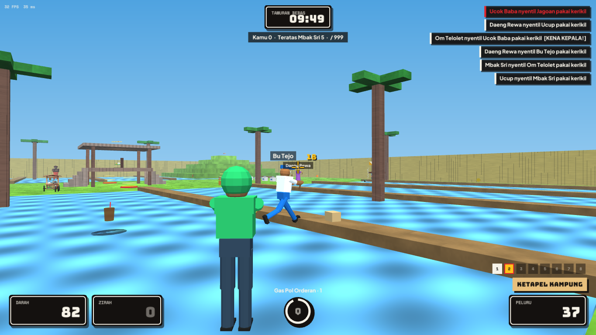

# Dokumentasi Djancoeg Tournament (Bahasa Indonesia)

*Dibuat oleh Ariana Mischa Fadhila dari Syubadubin Studios.* · [English](../en/README.md)

1. [Memulai](memulai.md) — instalasi, build, menjalankan, opsi baris perintah, solusi masalah
2. [Gameplay](gameplay.md) — kontrol, jagoan, jurus, senjata, item, arena, mode
3. [Multiplayer & server](multiplayer.md) — latihan, buka server, LAN, online, dedicated server, master server
4. [Modding](modding.md) — format mod, menambah jagoan/senjata/arena, paket dan Workshop
5. [Arsitektur](arsitektur.md) — susunan kode, netcode, performa, dan memori
6. [Pipeline aset](aset.md) — karakter Blender, aset Rodin, membuat ulang screenshot
7. [Kampanye, editor & pencapaian](kampanye-dan-editor.md) — Tur Nusantara, editor arena, kehancuran, pencapaian, distribusi
8. [Kit promosi](../marketing/README.md) — banner, postingan media sosial, kapsul Steam, logo, lembar fakta

