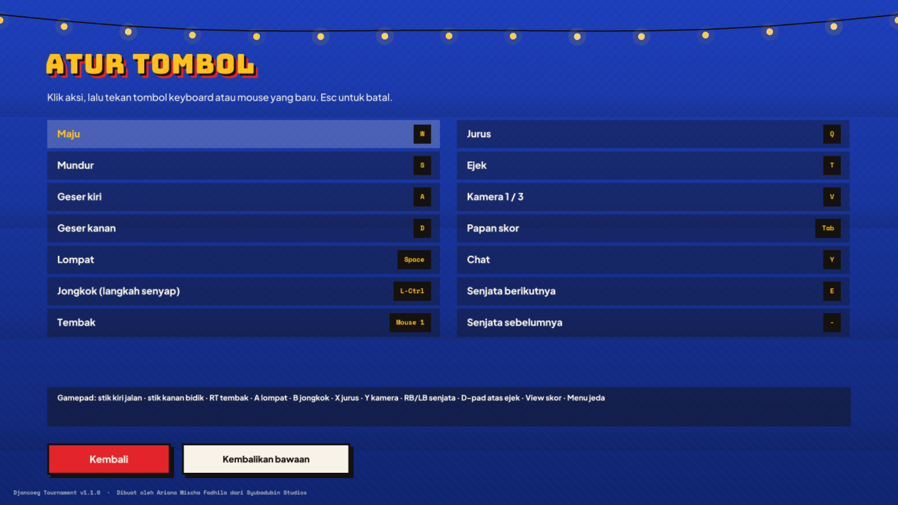
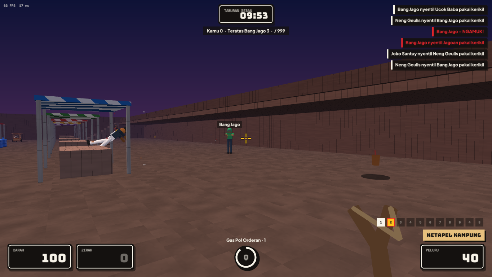
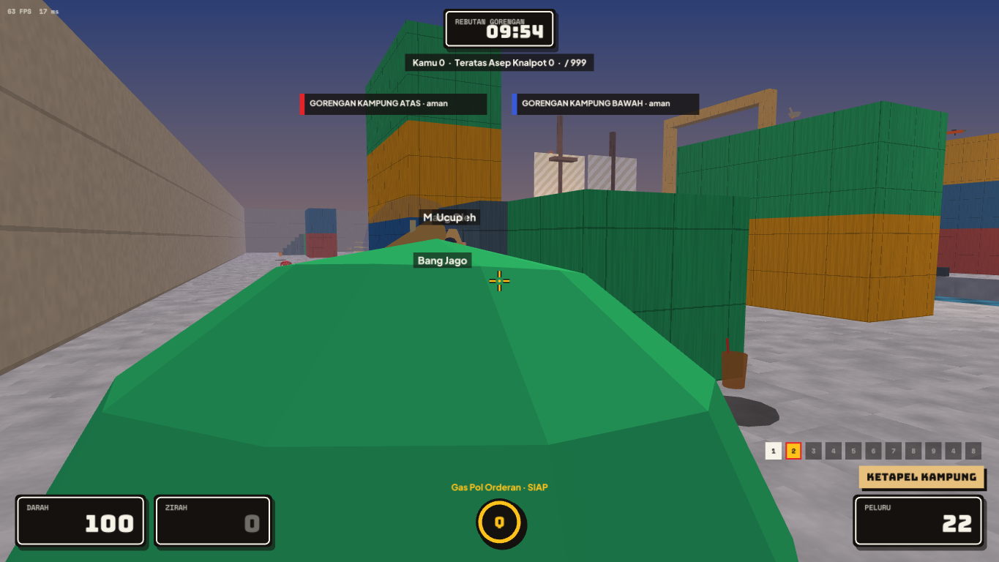
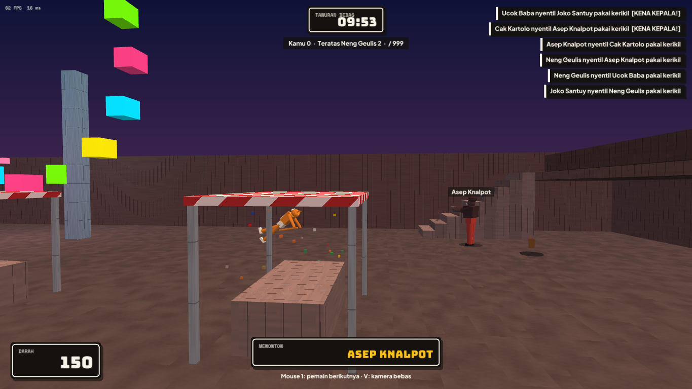

# Gameplay

*Dibuat oleh Ariana Mischa Fadhila dari Syubadubin Studios.*

## Kontrol

| Tombol | Aksi |
|---|---|
| W A S D | Jalan (gaya Quake: bunny-hop menjaga kecepatan) |
| Spasi | Lompat (tahan untuk lompat terus) |
| Ctrl / C | Jongkok |
| Klik kiri | Tembak |
| Q / klik kanan | Jurus |
| 1–7, scroll mouse | Ganti senjata |
| V | Kamera orang pertama / ketiga |
| T | Ejek (balon kata) |
| Tab | Papan skor |
| Y | Chat |
| Esc | Menu jeda (ganti jagoan, kamera, pengaturan, keluar) |

Semua aksi kecuali tombol angka senjata bisa **diatur ulang** di *Pengaturan → Atur tombol* (klik aksi, lalu tekan tombol keyboard atau mouse yang baru). Tombol panah, C (jongkok), klik kanan (jurus), dan scroll mouse selalu berfungsi sebagai cadangan.

**Gamepad** (tata letak XInput): stik kiri jalan · stik kanan bidik · RT tembak · A lompat · B jongkok · X jurus · Y kamera · RB/LB senjata · D-pad atas ejek · View papan skor · Menu jeda. Menu bisa dipakai dengan D-pad, A (pilih), dan B (kembali).

## Crosshair dan suara

Crosshair berubah sesuai senjata: lingkaran untuk raket, cincin seukuran sebaran peluru asli untuk Shotgun Panci, garis panjang untuk Bambu Runcing yang menembus, tanda jatuh untuk proyektil melengkung, dan cincin ledakan untuk senjata peledak. Kena kepala punya bunyi *ting* sendiri. Suara langkah mengikuti permukaan (papan, logam, keramik, rumput, air, terpal) — **jongkok untuk bergerak tanpa suara**.

## HUD

Info vital dilukis seperti pelat nomor kendaraan: **Darah** dan **Zirah** di kiri bawah, **Peluru** di kanan bawah lengkap dengan label nama senjata dan deretan slot di atasnya. Lingkaran di tengah adalah jeda jurus; berubah kuning dengan tulisan **SIAP** saat bisa dipakai. Jam pertandingan dan baris skor ada di atas, dan kabar pembunuhan di kanan memberi tahu siapa *nyentil* siapa.

## Jagoan

| Jagoan | Kategori | Darah | Kecepatan | Jurus |
|---|---|---|---|---|
| Gatot Kaca | Legenda | 110 | 100% | **Otot Kawat Tulang Besi** — lompatan super |
| Si Pitung | Legenda | 100 | 105% | **Golok Kilat** — melesat |
| Malin Kundang | Legenda | 120 | 95% | **Kutukan Bunda** — kulit batu (damage tinggal 35%, 5 detik) |
| Tukang Ojol | Profesi | 100 | 110% | **Gas Pol Orderan** — ngebut (gerak ×1,5, tembak lebih cepat) |
| Emak-Emak Daster | Profesi | 115 | 100% | **Omelan Emak** — gelombang kejut |
| Satpam Komplek | Profesi | 110 | 100% | **Kopi Pos Ronda** — pulih seketika |
| Pocong | Hantu | 100 | 100% (lompat 125%) | **Lompat Pocong** — lompatan raksasa |
| Kuntilanak | Hantu | 90 | 105% | **Hihihi Menghilang** — tak terlihat sampai menembak |
| Tuyul | Hantu | 75 | 120%, mungil | **Kabur Nyolong** — ngebut |
| Genderuwo | Hantu | 150 | 85%, besar | **Raungan Rimba** — gelombang kejut besar |
| Komodo | Hewan | 130 | 95% | **Terjangan Naga** — terjang dan gigit yang tertabrak |
| Kucing Oren | Hewan | 85 | 115%, kecil | **Mode Barbar** — ngebut |
| Bocil Kematian | Meme | 80 | 112%, kecil | **Teriak Mabar** — gelombang kejut |
| Si Kancil | Legenda | 80 | 115%, kecil | **Lompat Cerdik** — pindah kilat sampai 9 m ke arah pandangan |
| Leak | Hantu | 95 | 100% | **Terbang Malam** — melayang 5 detik, tahan lompat untuk naik |
| Tukang Parkir | Profesi | 105 | 100% | **Terus, Terus, Mundur!** — peluit yang menarik semua orang di dekatmu |
| Bapak-Bapak Ronda | Meme | 125 | 95%, besar | **Kentongan Bahaya** — pulih 30 dan ngebut untuk diri sendiri dan teman setim di dekatmu |

Ukuran berpengaruh: jagoan kecil lebih susah ditembak, jagoan besar lebih susah didorong. Contoh mod menambahkan **Abang Bakso** (jurus *Gerobak Ngebut*).

## Senjata

| Slot | Senjata | Jenis | Catatan |
|---|---|---|---|
| 1 | Raket Nyamuk Listrik | Jarak dekat | Selalu ada, damage 45, dorongan besar |
| 2 | Ketapel Kampung | Hitscan | Senjata awal, akurat, kena kepala ×1,5 |
| 3 | Shotgun Panci | Hitscan 9 peluru | Mematikan dari dekat |
| 4 | Gatling Sandal Jepit | Proyektil | Hujan sandal, bidik ke depan target |
| 5 | Petasan Banting | Proyektil memantul | Ledakan area, cocok buat pojokan |
| 6 | Bazooka Sambal | Roket | Ledakan besar; tembak kaki sambil lompat untuk **rocket jump** |
| 7 | Bambu Runcing Sakti | Hitscan menembus | Tembus semua yang berbaris |
| 8 | Cobek Lempar | Lemparan berat | Damage 95 kalau kena langsung, lengkungan tinggi |
| 9 | Kipas Sate | Hembusan angin | Mendorong pemain dan properti jatuh, dan **memantulkan proyektil musuh** |
| 4 | Kerupuk Shuriken | 3 proyektil cepat | Satu slot dengan Gatling — tekan 4 lagi untuk ganti |

Senjata yang berbagi tombol angka akan bergiliran saat tombolnya ditekan lagi.

Ledakan yang mengenai diri sendiri hanya separuh damage, tapi dorongannya penuh — itulah cara rocket jump.

## Item

| Item | Efek |
|---|---|
| Es Teh Manis | +25 darah (sampai maksimal) |
| Nasi Padang | +100 darah, bisa sampai 200 (berkurang pelan-pelan) |
| Helm SNI | +50 zirah (zirah menyerap ⅔ damage) |
| Rompi | +15 zirah |
| Kardus amunisi | Peluru untuk semua senjata yang dimiliki |
| Jamu | Damage ×3 selama 15 detik — pemiliknya bersinar merah |
| Senjata | Senjata plus peluru |

## Fisika kacau

- **Dorongan (knockback)** dari setiap serangan; ledakan melempar pemain dan properti.
- **Properti** (gerobak, galon, peti, karung, ban) bisa ditendang, ditembak, dan diledakkan. Properti yang terbang lebih dari ~9 m/s melukai yang tertabrak — poinnya untuk yang terakhir menyentuh.
- **Kasur lompat** melempar ke jalan layang, atap, dan kanopi panggung.
- **Kali dan jurang**: jatuh keluar arena berarti tewas; yang terakhir menyerangmu dalam 5 detik mendapat poin.

## Arena

| Arena | Suasana | Sorotan |
|---|---|---|
| Pasar Malam Ceria | Malam, lampu bohlam | Panggung dangdut dengan kanopi, atap tenda yang bisa dipijak, jalan layang, bianglala |
| Terminal Antar Kota | Senja | Jembatan penyeberangan, peron, atap bus lewat kasur lompat |
| Sawah & Pos Ronda | Siang terang | Sawah terbuka, terasering, pos ronda — surganya penembak jitu |
| Atap Kampung | Matahari terbenam | Atap berbeda tinggi, gang sempit, kali yang bisa bikin kecebur |
| Pelabuhan Sunda Kelapa | Subuh | Tumpukan kontainer, kapal pinisi dengan sarang pengintai, kanal yang bisa bikin kecebur |
| Stasiun Kereta Tua | Sore | Atap gerbong, jembatan penyeberangan, menara jam |
| Kantor Kelurahan | Siang | Ruangan dan loket di dalam gedung, halaman dengan tiang bendera, atap yang bisa dipijak |
| Lapangan Tujuhbelasan (mod) | Siang | Panjat pinang dengan Jamu di puncaknya |

## Mode

| Mode | Aturan |
|---|---|
| **Tawuran Bebas** | +1 tiap membunuh, −1 tiap bunuh diri. Duluan capai batas skor, atau skor tertinggi saat waktu habis. |
| **Perang Kampung** | Kampung Atas vs Kampung Bawah. Skor dihitung per tim; tembak teman mati secara bawaan. |
| **Raja Warung** | Berdiri di zona **sendirian** untuk dapat 1 poin per detik. Dua orang di dalam = direbutkan. |
| **Rebutan Gorengan** | Capture the flag dengan pisang goreng raksasa. Rebut gorengan kampung lawan lalu bawa ke piringmu selama gorenganmu ada di rumah (tim +1, pembawa +5). Gorengan yang jatuh pulang sendiri setelah 20 detik atau saat disentuh pembela. |
| **Panjat Pinang** | Balapan ke hadiah di puncak arena (sarang pengintai, menara jam, atap kantor…). Sentuh untuk dapat poin, lalu mulai lagi dari titik lahir. Jatuhkan yang sedang memanjat! |

Setelah pertandingan selesai papan skor menampilkan pemenang selama 10 detik; server yang dibuka lalu pindah ke arena berikutnya.

## Kill cam dan menonton

Saat kamu tumbang, kamera naik dari tubuhmu dan mengarah ke yang menghajarmu, lengkap dengan sisa darahnya, sampai kamu bangkit lagi.

**Tonton** pertandingan lewat tombol *Tonton* di pencari server, atau *Nonton saja* di pengaturan latihan untuk menonton bot. Tembak (atau Senjata berikutnya) berpindah ke pemain lain, Jurus/Senjata sebelumnya kembali, dan tombol kamera beralih ke **kamera bebas** (tombol gerak, Lompat/Jongkok untuk naik/turun, Shift untuk ngebut). Penonton tidak memakai slot pemain (maksimal 8 per server).

## Grafis dan aksesibilitas

| Tab pengaturan | Pilihan |
|---|---|
| Grafis | Kualitas efek (jumlah lampu dan partikel), skala render 3D (50–100%, cocok untuk GPU lambat), sudut pandang, bayangan bulat, MSAA (perlu buka ulang), layar penuh, FPS/ping |
| Aksesibilitas | Warna tim ramah buta warna (oranye/biru langit menggantikan merah/biru dan label hijau/merah), subtitle suara penyiar, kurangi guncangan layar, kurangi kilatan |

