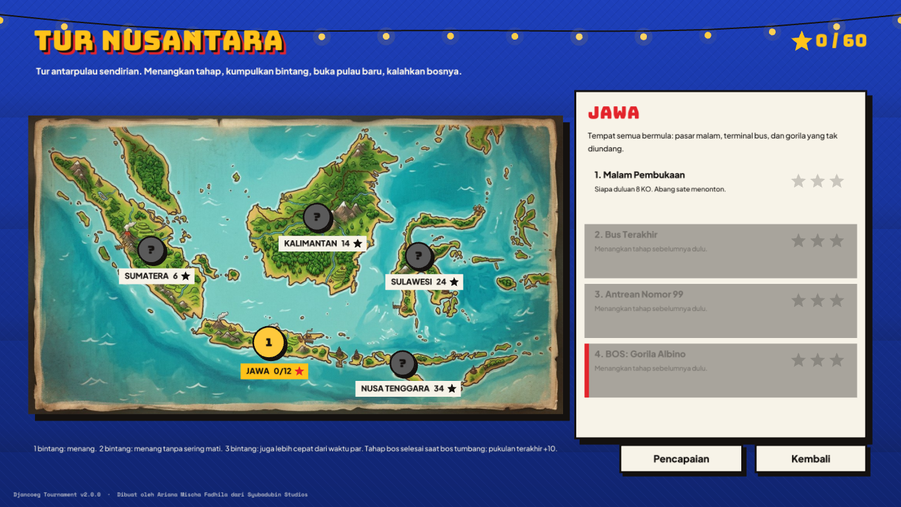
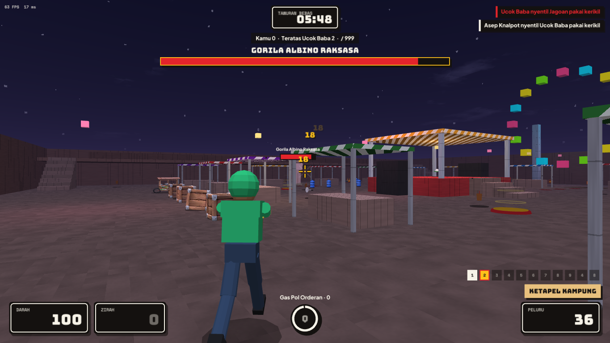
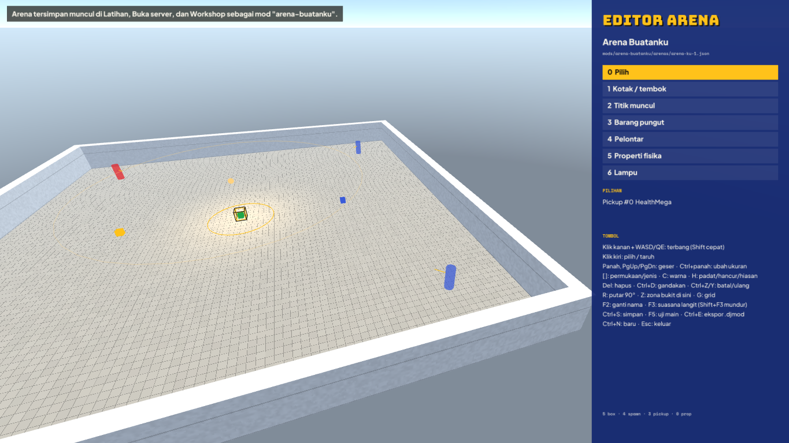
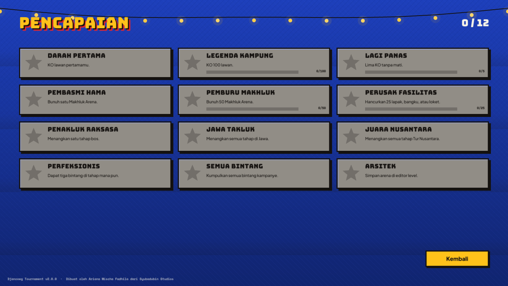

# Tur Nusantara, editor arena & pencapaian

*Dibuat oleh Ariana Mischa Fadhila dari Syubadubin Studios.* · [English](../en/campaign-and-editor.md)

Versi 2.0 "Nusantara Raya" menambahkan kampanye pemain tunggal, editor arena di dalam game, pencapaian lokal, lapak yang bisa hancur, dan mayat berfisika.

## Tur Nusantara (kampanye)

Pilih **Tur Nusantara (kampanye)** di urutan teratas menu utama.

- **Lima pulau, masing-masing empat tahap.** Jawa → Sumatera → Kalimantan → Sulawesi → Nusa Tenggara (tur bonus, 34 bintang, dua bos: Si Jangkung dan Cacing Tanah Raksasa). Setiap tahap adalah pertandingan sungguhan melawan bot di salah satu arena, dengan salah satu dari lima mode.
- **Bintang.**
  - ★ Menangkan tahap.
  - ★★ Menang tanpa mati melebihi batas tahap.
  - ★★★ Itu juga, ditambah selesai dalam waktu par.

  Hasil terbaik yang disimpan.
- **Membuka tahap.**
  - Tahap terbuka bila tahap sebelumnya punya minimal satu bintang.
  - Pulau terbuka bila total bintangmu mencapai syaratnya: Sumatera 6, Kalimantan 14, Sulawesi 24.
- **Bos.** Tahap terakhir tiap pulau adalah pertarungan bos:

  | Pulau | Bos |
  |---|---|
  | Jawa | Gorila Albino |
  | Sumatera | Cyclops |
  | Kalimantan | Kepala Raksasa Melayang |
  | Sulawesi | Buto Ijo |

  - Bos adalah Makhluk Arena dengan nyawa 5–6× lipat dan bar nyawa di atas layar.
  - Ia muncul lagi kalau kabur, masuk ke tanah, atau jatuh, dengan luka yang sudah kamu berikan tetap terbawa.
  - Pukulan terakhir bernilai **+10 poin**. Pertandingan selesai saat bos tumbang, dan pemimpin skor menang.
- **Progres** disimpan di `campaign.json` dalam folder app-data (`%APPDATA%/DjancoegTournament` di Windows, `~/.config/DjancoegTournament` di Linux/macOS).

Tahap didefinisikan di kode (`src/Djancoeg.Core/Content/Campaign.cs`). Setiap `CampaignStage` diubah jadi `MatchSettings` biasa; tahap bos memakai `BossCreepId` dan `BossHealthScale`. Server dedicated pun bisa memakai kolom yang sama.

## Editor arena

Pilih **Editor arena** di menu utama. Editor membuka arena yang terakhir kamu simpan, atau arena awal baru berisi lantai, tembok, empat titik muncul, dan beberapa barang pungut.

| Aksi | Tombol |
|---|---|
| Terbang | Tahan klik kanan + WASD, Q/E turun/naik, Shift lebih cepat |
| Alat | `0` pilih · `1` kotak/tembok · `2` titik muncul · `3` barang pungut · `4` pelontar · `5` properti fisika · `6` lampu (atau klik di panel) |
| Pilih / taruh | Klik kiri (penempatan mengikuti grid dan mendarat di permukaan di bawah kursor) |
| Geser | Tombol panah (relatif ke kamera) · PgUp/PgDn naik/turun |
| Ubah ukuran | Ctrl + panah / PgUp/PgDn (kotak, pelontar; lampu mengubah jangkauan) |
| Gaya | `[` `]` permukaan / jenis barang / tim titik muncul / jenis properti / kekuatan pelontar · `C` warna |
| Jenis kotak | `H` berganti padat → **bisa hancur** (120 HP) → hiasan |
| Sunting | Del hapus · Ctrl+D gandakan · Ctrl+Z / Ctrl+Y batal / ulang |
| Lainnya | `R` putar 90° · `Z` zona Raja Warung di sini · `G` grid 0,25/0,5/1 · `F2` ganti nama · `F3` suasana langit (siang, senja, malam, mendung) |
| Berkas | Ctrl+S simpan · **F5 uji main** melawan 3 bot · Ctrl+E ekspor `.djmod` untuk dibagikan · Ctrl+N baru · Esc keluar |

- **Menyimpan.** Arena disimpan sebagai mod biasa di `mods/arena-buatanku/` (`mod.json` dan `arenas/<id>.json`). Arena muncul di Latihan, Buka server, dan Workshop, bisa dipak menjadi `.djmod`, dan dibagikan seperti mod lain.
- **Validasi.** Editor menolak menyimpan arena yang akan ditolak validator mod (misalnya titik muncul kurang dari 2) dan menampilkan alasannya.
- **Uji main.** **F5** menyimpan, memuat ulang konten, lalu memulai pertandingan latihan. **Tinggalkan pertandingan** membawamu kembali ke editor.

Logika penyuntingan (`ArenaEditor` di `src/Djancoeg.Modding`) tidak memakai kode jendela, jadi diuji dengan unit test: penempatan, grid, batal/ulang, pemilihan dengan sinar, dan penyimpanan.

## Lapak yang bisa hancur & mayat berfisika

- **Kotak yang bisa hancur.** Kotak arena dengan `"health": <hp>` bisa dihancurkan. Peluru, serangan jarak dekat, proyektil, dan ledakan semuanya merusaknya.
  - Kotak hancur bawaan: meja dan tenda lapak pasar malam, bangku terminal, toren air di atap, serta loket dan meja kantor kelurahan.
  - Kotak yang hancur menghilang, tidak lagi menghalangi gerakan dan tembakan, dan pecah jadi serpihan dan debu.
  - Kotak pecah jadi bongkahan besar yang terguling dan tergeletak di tanah sampai kotak kembali setelah 45 detik (kecuali ada yang berdiri di tempatnya).
- **Mayat berfisika.** Jagoan dan makhluk meninggalkan mayat berfisika yang terlempar oleh pukulan, memantul di dunia, mencipratkan darah (atau konfeti), lalu rebah sebelum memudar.

## Pencapaian

Ada 12 pencapaian lokal, terbuka lewat hal seperti KO pertama, membunuh makhluk, menghancurkan lapak, menaklukkan pulau, mengumpulkan bintang, dan menyimpan arena. Notifikasi muncul saat pencapaian terbuka. Buka daftarnya lewat tombol **Pencapaian** di peta kampanye.

Progres disimpan di `achievements.json` dalam folder app-data. `distribution/steam/achievements.json` memetakan setiap id ke nama API Steamworks.

## Distribusi

Lihat [`distribution/README.md`](../../distribution/README.md).

- GitHub Actions membangun dan menguji setiap push dan pull request.
- Tag `v*` menerbitkan zip Windows, Linux, dan macOS ke GitHub Release, dan mengunggah ke itch.io lewat butler bila secret `BUTLER_API_KEY` diisi.
- Templat ContentBuilder Steamworks (`app_build.vdf`, `depot_build_*.vdf`) siap diisi.
