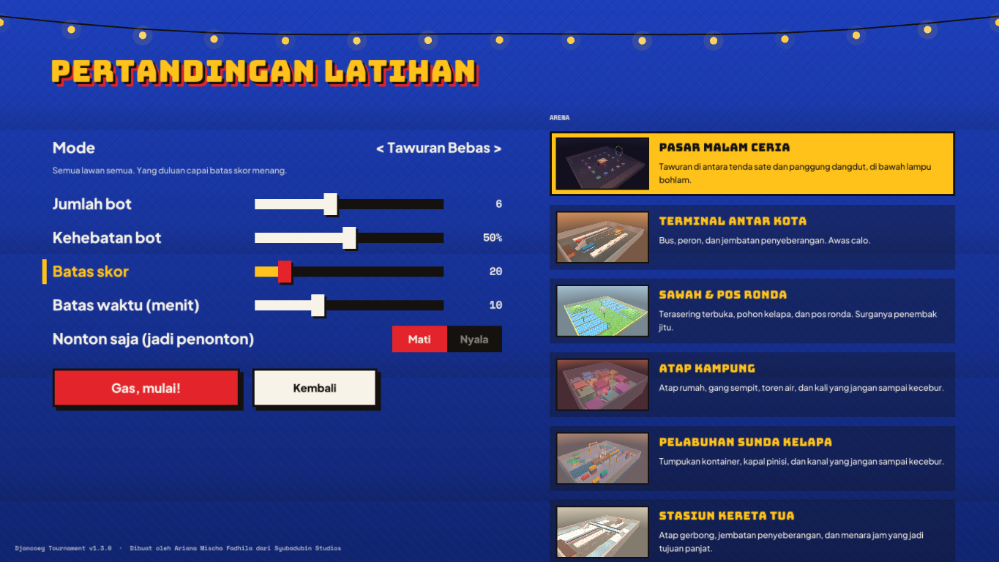

# Memulai

*Dibuat oleh Ariana Mischa Fadhila dari Syubadubin Studios.*

## Kebutuhan

- **.NET 10 SDK** (10.0.100 atau lebih baru) — cek dengan `dotnet --version`
- GPU dan driver dengan **OpenGL 3.3** (GPU apa pun dari 10 tahun terakhir, termasuk grafis bawaan/integrated)
- Windows 10/11, desktop Linux modern (X11 atau Wayland/XWayland), atau macOS 12+

Library native raylib untuk `win-x64`, `win-x86`, `linux-x64`, `osx-x64`, dan `osx-arm64` sudah ikut di paket NuGet Raylib-cs, jadi tidak perlu instal apa-apa lagi.

## Build, tes, jalankan

```bash
git clone <repo> && cd DjancoegTournament
dotnet build                    # build ke-6 proyek
dotnet test                     # 93 tes: fisika, pertarungan, arena, bot, jaringan, mod
dotnet run --project src/Djancoeg.Client
```

Supaya frame rate paling mulus, mainkan build Release:

```bash
dotnet run --project src/Djancoeg.Client -c Release
```

Menjalankan satu tes atau sekelompok tes:

```bash
dotnet test --filter "FullyQualifiedName~MovementTests.Player_climbs_stairs"
dotnet test --filter "FullyQualifiedName~LoopbackTests"
```

## Pertandingan pertama

1. **Pilih jagoan** — pilih karakter dan ketik namamu.
2. **Latihan lawan bot** — pilih arena, mode, jumlah bot, dan kehebatannya.
3. **Gas, mulai!** Tekan **Esc** untuk menu jeda dan **Tab** untuk papan skor.



## Opsi baris perintah game

| Opsi | Arti |
|---|---|
| `--connect host:port` | Langsung gabung ke server saat dibuka |
| `--lang en` / `--lang id` | Paksa bahasa antarmuka |
| `--size 1600x900` | Ukuran jendela (otomatis mengecil agar muat di monitor) |
| `--novsync` | Matikan VSync (untuk benchmark) |
| `--shot <scene> --out file.png [--arena id] [--delay s]` | Render satu layar lalu simpan screenshot (lihat [aset.md](aset.md)) |

Pengaturan disimpan di `%APPDATA%/DjancoegTournament/settings.json` (Windows) atau `~/.config/DjancoegTournament/settings.json` (Linux/macOS).

## Paket rilis

```powershell
pwsh scripts/publish.ps1                       # semua platform -> artifacts/*.zip
pwsh scripts/publish.ps1 -Runtimes win-x64
```
```bash
scripts/publish.sh linux-x64                   # -> artifacts/*.tar.gz
```

Setiap paket mandiri (tidak butuh instalasi .NET) dan berisi game (`DjancoegTournament`) serta server (`djancoeg-server`).

## Solusi masalah

| Masalah | Solusi |
|---|---|
| Layar hitam atau crash saat dibuka | Perbarui driver GPU; game butuh OpenGL 3.3. Di VM Linux, aktifkan akselerasi 3D. |
| "Content mismatch" saat gabung | Server memakai mod yang berbeda. Aktifkan mod yang sama di Workshop (nama mod tercantum di pesan). |
| Tidak ada yang bisa gabung ke server saya | Izinkan UDP port 27960 di firewall; untuk internet, forward UDP 27960 di router. |
| Tidak ada suara | Cek slider volume di Pengaturan; di Linux pastikan PulseAudio/PipeWire berjalan. |
| Kursor terkunci di jendela | Tekan **Esc** untuk membuka menu jeda, kursor akan dilepas. |
