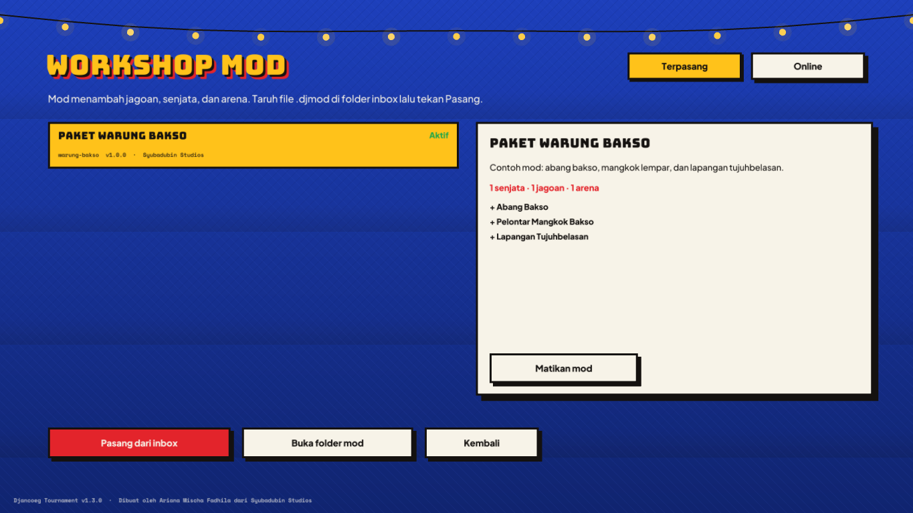
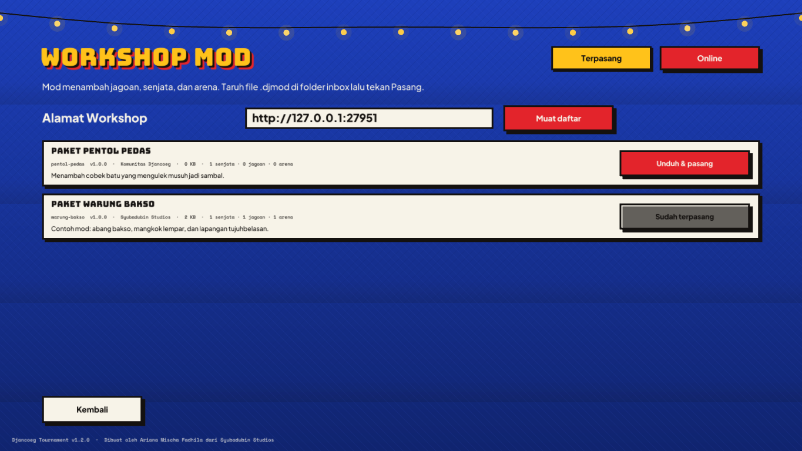

# Modding

*Dibuat oleh Ariana Mischa Fadhila dari Syubadubin Studios.*

Semua perilaku jagoan, senjata, dan arena berupa data, jadi mod tidak butuh kode — cukup JSON (plus model dan gambar kalau mau).



## Lokasi mod

```
mods/
  warung-bakso/           <- satu folder per mod (nama folder = urutan muat)
    mod.json              <- manifest
    arenas/lapangan-17an.json
  settings.json           <- mod yang dinonaktifkan (ditulis oleh Workshop)
  _inbox/                 <- taruh paket .djmod di sini, lalu tekan "Pasang dari inbox"
```

Game memuat folder `mods/` di sebelah file game. Mod diterapkan setelah konten bawaan, urut nama folder; item dengan id yang sudah ada akan **menggantikannya** (misalnya mod bisa menyeimbangkan ulang `bazooka-sambal`).

## Alat

```bash
djancoeg-server mod new mod-saya               # buat mods/mod-saya/mod.json berisi contoh senjata
djancoeg-server mod validate mods/mod-saya     # cek kesalahan
djancoeg-server mod pack mods/mod-saya ./out   # -> out/mod-saya-1.0.0.djmod (zip)
djancoeg-server mod install mod-saya-1.0.0.djmod
djancoeg-server mod list
```

(Dari source: `dotnet run --project src/Djancoeg.Server -- mod ...`.)

## Manifest

```json
{
  "id": "warung-bakso",
  "name": { "en": "Meatball Stall Pack", "id": "Paket Warung Bakso" },
  "description": { "en": "…", "id": "…" },
  "author": "Syubadubin Studios",
  "version": "1.0.0",
  "gameVersion": "1.0",
  "weapons": [ … ],
  "characters": [ … ],
  "arenas": [ … ],
  "arenaFiles": ["arenas/lapangan-17an.json"]
}
```

Id memakai `a-z`, `0-9`, dan `-` (2–40 karakter). Setiap teks berupa pasangan `{ "en": "…", "id": "…" }`; kalau satu bahasa kosong, bahasa lainnya yang tampil. Field yang tidak diisi memakai nilai bawaan. Komentar dan koma di akhir diperbolehkan.

## Senjata

```json
{
  "id": "mangkok-bakso", "slot": 8, "kind": "Projectile", "model": "firecracker", "color": "#FFCC80",
  "name": { "en": "Meatball Bowl Lobber", "id": "Pelontar Mangkok Bakso" },
  "killVerb": { "en": "{killer} served {victim} a scalding bowl", "id": "{killer} menyiram {victim} pakai kuah bakso panas" },
  "damage": 40, "splashDamage": 45, "splashRadius": 2.8, "knockback": 7, "fireInterval": 0.7,
  "projectileSpeed": 22, "projectileGravity": 14, "projectileLifetime": 3,
  "maxAmmo": 30, "startAmmo": 8, "pickupAmmo": 8
}
```

| Field | Bawaan | Catatan |
|---|---|---|
| `kind` | Hitscan | `Melee`, `Hitscan`, `Projectile`, atau `Blast` (kerucut angin: dorongan + memantulkan proyektil; memakai `range` dan `blastConeDegrees`) |
| `slot` | 1 | Tombol 1–9 |
| `damage` | 10 | Per peluru / kena langsung (0–500) |
| `fireInterval` | 0.5 | Detik antar tembakan (≥ 0.05) |
| `pellets`, `spreadDegrees` | 1, 0 | Sebaran ala shotgun |
| `range` | 200 | Jangkauan hitscan/jarak dekat (meter) |
| `projectileSpeed`, `projectileGravity`, `projectileLifetime`, `projectileBounces` | 30, 0, 5, false | Perilaku proyektil |
| `splashRadius`, `splashDamage` | 0, 0 | Ledakan saat kena atau saat umur habis |
| `knockback`, `selfDamageScale` | 2, 0.5 | Gaya dorong; porsi damage ledakan ke diri sendiri |
| `maxAmmo`, `startAmmo`, `pickupAmmo`, `infiniteAmmo` | 100, 25, 10, false | Peluru |
| `piercing` | false | Hitscan menembus semua yang segaris |
| `startsWith` | false | Semua jagoan langsung punya |
| `model` | slingshot | `racket`, `slingshot`, `pan`, `sandal`, `firecracker`, `bazooka`, `bamboo`, `cobek`, `fan`, `kerupuk` |
| `blastConeDegrees` | 35 | Setengah sudut kerucut senjata `Blast` |
| `killVerb` | | Kalimat kabar pembunuhan dengan `{killer}` dan `{victim}` |

Senjata didapat saat lahir (`startsWith`) atau dari item `Weapon` di arena.

## Jagoan

```json
{
  "id": "abang-bakso", "category": "Profession", "shape": "Humanoid",
  "name": { "en": "Meatball Seller", "id": "Abang Bakso" },
  "description": { "en": "…", "id": "…" },
  "maxHealth": 105, "speedMultiplier": 1.0, "jumpMultiplier": 1.0, "scale": 1.0,
  "primaryColor": "#FFFFFF", "secondaryColor": "#1565C0", "skinColor": "#A0663C",
  "ability": { "kind": "Dash", "cooldown": 7, "power": 1.1, "name": { … }, "description": { … } },
  "taunts": [ { "en": "Meatballs! Hot meatballs!", "id": "Baksooo! Bakso panas!" } ],
  "model": "models/characters/abang-bakso.glb",
  "portrait": "art/portraits/abang-bakso.png"
}
```

| Field | Rentang | Catatan |
|---|---|---|
| `category` | Legend, Profession, Ghost, Animal, Meme | Tampil di kartu jagoan |
| `maxHealth` | 25–300 | |
| `speedMultiplier` | 0.5–1.6 | |
| `jumpMultiplier` | 0.5–2 | |
| `scale` | 0.5–1.6 | Mengubah hitbox juga |
| `ability.kind` | SuperJump, Dash, Shockwave, Heal, Invisibility, Haste, StoneSkin, Teleport, Levitate, Pull, Rally, None | `power`: kekuatan lompat/melesat/gelombang, jumlah pulih, pengali ngebut, atau faktor damage untuk StoneSkin; `duration` untuk jurus berdurasi |
| `model`, `portrait` | opsional | Path relatif terhadap folder `assets/` game. Tanpa model, game menggambar kapsul berwarna; tanpa potret, kotak warna. |

Untuk model ber-rig dengan gaya yang sama, tambahkan jagoanmu di `tools/blender/build_characters.py` (lihat [aset.md](aset.md)) — game memakai klip bernama `idle`, `run`, `shoot`, dan `die`.

## Arena

Arena adalah daftar kotak sejajar sumbu plus penanda gameplay. Satuan meter, **Y ke atas**, tinggi pemain 1,8 m, bisa naik undakan 0,5 m dan lompat sekitar 1,2 m.

```json
{
  "id": "lapangan-17an",
  "name": { "en": "Independence Day Field", "id": "Lapangan Tujuhbelasan" },
  "skyTop": "#3A7BD5", "skyBottom": "#FFFFFF", "fogColor": "#D6E9FF", "fogDensity": 0.008,
  "ambientColor": "#9AA9BF", "sunColor": "#FFF8E1", "sunDirection": [-0.3, -0.9, 0.2],
  "killY": -20, "zoneCenter": [0, 9.3, 0], "zoneRadius": 1.6,
  "boxes":    [ { "min": [-30,-1,-30], "max": [30,0,30], "surface": "Grass", "color": "#7CB342" } ],
  "spawns":   [ { "position": [-26,0,-26], "yaw": 0.78, "team": 0 } ],
  "pickups":  [ { "position": [0,9.3,0], "kind": "Quad", "respawnSeconds": 45 },
                { "position": [-15,0,-18], "kind": "Weapon", "weapon": "mangkok-bakso" } ],
  "jumpPads": [ { "min": [-5.8,0,-0.8], "max": [-4.2,0.25,0.8], "launch": [2.92,20.5,0] } ],
  "props":    [ { "kind": "galon", "position": [8,0.5,8], "halfExtents": [0.28,0.5,0.28], "mass": 18, "color": "#4FC3F7" } ],
  "lights":   [ { "position": [0,10,0], "color": "#FFEB3B", "radius": 12 } ]
}
```

| Elemen | Catatan |
|---|---|
| `boxes[].surface` | Ground, Wall, Wood, Metal, Fabric (terpal bergaris), Water (beranimasi), Grass, Tile, Neon (bersinar), Roof (seng) |
| `boxes[].solid` | `false` untuk hiasan (lampu, bendera, jemuran) |
| `spawns[].team` | 0, 1, atau -1 untuk tim mana saja; `yaw` dalam radian (0 menghadap +Z) |
| `pickups[].kind` | HealthSmall, HealthMega, Armor, ArmorSmall, Weapon, Ammo, Quad |
| `jumpPads[].launch` | Kecepatan dalam m/s. Gravitasi 20 m/s². Untuk mendarat di satu titik: `v_y = sqrt(2·20·(puncak−y0))`, lalu horizontal = jarak / waktu terbang. |
| `props[].kind` | crate, galon, gerobak, karung, ban, kursi, motor, jerigen (menentukan model) |
| `flagBases` | Opsional `[[x,y,z],[x,y,z]]` piring gorengan tim 0 dan 1 (Rebutan Gorengan); kalau kosong, pusat titik lahir tiap tim |
| `raceGoal` | Opsional `[x,y,z]` hadiah Panjat Pinang; kalau kosong, `zoneCenter` (radius = `zoneRadius`) |
| `killY` | Jatuh di bawah ketinggian ini = tewas |
| `skyTop`, `skyBottom`, `sunColor`, `sunDirection` | Langit prosedural: warna zenit dan cakrawala, warna matahari, dan arah cahayanya |
| `cloudCoverage`, `cloudColor`, `cloudSpeed` | Awan: 0 = cerah, 1 = mendung; warna; kecepatan geser (bawaan 0.4, putih, 0.006) |
| `night` | `true` menampilkan bintang dan bulan, bukan matahari |
| `skyTexture` | Opsional: panorama equirectangular (JPG/PNG 2:1, misalnya HDRI CC0 dari Poly Haven yang dikonversi ke 8-bit), path relatif ke `assets/` atau absolut; awan tetap digambar di atasnya |
| `zoneCenter`, `zoneRadius` | Zona Raja Warung |

Batas: 1–4096 kotak, 64 item, 64 properti, minimal 2 spawn. Uji dengan bot: `djancoeg-server --arena arena-saya --bots 8` lalu lihat log, atau mainkan dari **Latihan**.

## Berbagi

1. `djancoeg-server mod validate mods/mod-saya`
2. `djancoeg-server mod pack mods/mod-saya`
3. Bagikan file `.djmod`. Pemain menaruhnya di `mods/_inbox/` lalu menekan **Pasang dari inbox** di Workshop, atau menjalankan `djancoeg-server mod install file.djmod`.

Paket berupa file zip; pemasang menolak isi yang mencoba menulis di luar folder mod.

## Workshop online

Siapa pun bisa membuka Workshop — folder berisi paket dan `index.json`, disajikan lewat HTTP:

```bash
djancoeg-server workshop publish mod-saya-1.0.0.djmod --dir ./workshop   # validasi, hitung hash, masukkan ke indeks
djancoeg-server workshop serve --dir ./workshop --port 27951            # http://host:27951/index.json
```

Pemain membuka **Workshop → Online**, mengisi alamatnya (juga ada di *Pengaturan → Umum*), lalu menekan **Unduh & pasang**. Game memeriksa SHA-256 setiap unduhan dengan indeks sebelum memasang, dan mod yang sudah ada ditandai *Sudah terpasang* atau *Perbarui*. Server bawaannya hanya-baca dan hanya menyajikan `index.json` dan `packages/*.djmod`; folder yang sama juga bisa ditaruh di web hosting statis atau CDN mana pun (HTTPS bisa).


