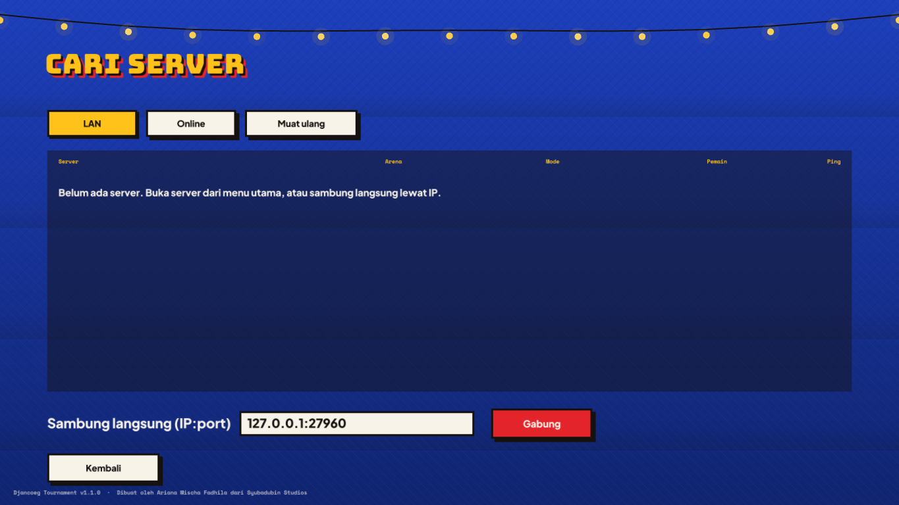

# Multiplayer & server

*Dibuat oleh Ariana Mischa Fadhila dari Syubadubin Studios.*

Semua cara bermain memakai kode server otoritatif yang sama. Latihan menjalankan server pribadi di `127.0.0.1` di dalam game; **Buka server** menjalankannya di semua antarmuka jaringan; dedicated server menjalankannya tanpa grafis.

## Cara bermain

| Menu | Yang terjadi |
|---|---|
| Latihan lawan bot | Server di dalam game, hanya loopback, port acak. Orang lain tidak bisa gabung. |
| Buka server | Server di dalam game pada UDP `27960` (bisa diubah). Terlihat di LAN; bisa didaftarkan ke master server. Arena berganti setiap pertandingan. |
| Cari server → LAN | Menyebar paket pencarian ke port 27960–27963 dan menampilkan semua server yang menjawab. |
| Cari server → Online | Meminta daftar dari master server (Pengaturan → *Alamat master server*), lalu ping tiap server. |
| Sambung langsung | Ketik `ip:port` atau `hostname:port`. |
| Tonton | Gabung ke server terpilih sebagai penonton (tanpa slot pemain, maksimal 8 per server). |



## Dedicated server

```bash
dotnet run --project src/Djancoeg.Server -c Release -- --name "Warung Tawuran" --arena pasar-malam --mode ffa --bots 6
# atau dari paket rilis:
./djancoeg-server --rotation pasar-malam,terminal-bus,sawah-ronda,atap-kampung --mode tdm --score 50 --time 900
```

| Opsi | Bawaan | Arti |
|---|---|---|
| `--port` | 27960 | Port UDP |
| `--name` | Warung Tawuran | Nama di daftar server |
| `--arena` | pasar-malam | Arena pertama (id arena bawaan atau mod) |
| `--rotation a,b,c` | — | Urutan arena setelah tiap pertandingan |
| `--mode` | ffa | `ffa`, `tdm`, atau `koth` |
| `--score` | 25 | Batas skor |
| `--time` | 600 | Batas waktu dalam detik (0 = tanpa batas) |
| `--bots` | 5 | Bot pengisi slot kosong (otomatis keluar saat pemain datang) |
| `--skill` | 0.5 | Kehebatan bot 0–1 |
| `--max` | 16 | Pemain maksimal (2–16) |
| `--friendly-fire` | mati | Damage ke teman setim di `tdm` |
| `--master host:port` | — | Daftarkan ke master server tiap 20 detik |
| `--mods dir` / `--no-mods` | ./mods | Folder mod, atau hanya konten bawaan |
| `--config file.json` | — | Muat pengaturan pertandingan dari JSON |

Contoh file `--config`:

```json
{ "Mode": "KingOfTheHill", "ArenaId": "sawah-ronda", "ScoreLimit": 120, "TimeLimitSeconds": 900, "BotCount": 4, "BotSkill": 0.7, "MaxPlayers": 12, "ServerName": "Raja Pos Ronda" }
```

Tekan **Ctrl+C** untuk berhenti; pemain akan diberi tahu.

### Menjalankan sebagai service (Linux)

```ini
# /etc/systemd/system/djancoeg.service
[Unit]
Description=Djancoeg Tournament server
After=network-online.target

[Service]
WorkingDirectory=/opt/djancoeg
ExecStart=/opt/djancoeg/djancoeg-server --rotation pasar-malam,terminal-bus,sawah-ronda,atap-kampung --bots 4 --master master.example.org:27950
Restart=on-failure
User=djancoeg

[Install]
WantedBy=multi-user.target
```

## Master server (daftar server online)

```bash
./djancoeg-server master --port 27950
```

Server game yang dijalankan dengan `--master host:27950` mengirim heartbeat tiap 20 detik dan dihapus dari daftar setelah 60 detik tanpa kabar. Pemain mengisi *Alamat master server* di Pengaturan lalu membuka **Cari server → Online**.

## Port dan firewall

| Port | Protokol | Untuk |
|---|---|---|
| 27960 | UDP | Server game (pemain menyambung ke sini; pencarian LAN juga) |
| 27950 | UDP | Master server (kalau kamu menjalankannya) |

Untuk server internet, forward port game di router. Hanya server yang butuh port terbuka; klien cukup mengirim UDP keluar.

## Mod dan multiplayer

Server dan setiap klien harus memuat konten yang sama. Saat menyambung, klien mengirim **tanda tangan konten** (hash dari semua id senjata, jagoan, dan arena beserta angka pentingnya). Kalau berbeda, server menolak dan menyebutkan mod yang dipakai. Di daftar server, server seperti itu ditandai *mod beda*.

## Netcode dalam satu paragraf

Server mensimulasikan pada **60 Hz** dan mengirim snapshot ke setiap klien pada **30 Hz**. Klien mengirim input setiap tick (4 input terakhir sekaligus, jadi paket hilang tidak berpengaruh), **memprediksi** gerakannya sendiri dengan kode gerak yang persis sama, lalu **merekonsiliasi** saat snapshot datang dengan memutar ulang input yang belum dikonfirmasi. Pemain lain **diinterpolasi** 100 ms di belakang. Senjata hitscan memakai **kompensasi lag**: server memundurkan posisi pemain lain sebesar latensi penembak + jeda interpolasi. Event (tembakan, kill, item) ikut di dalam snapshot dengan konfirmasi, jadi tidak pernah hilang. Detail: [arsitektur.md](arsitektur.md#jaringan).
