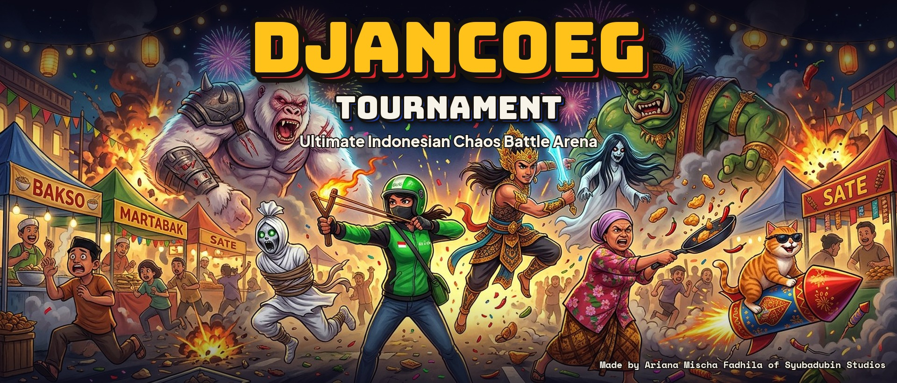
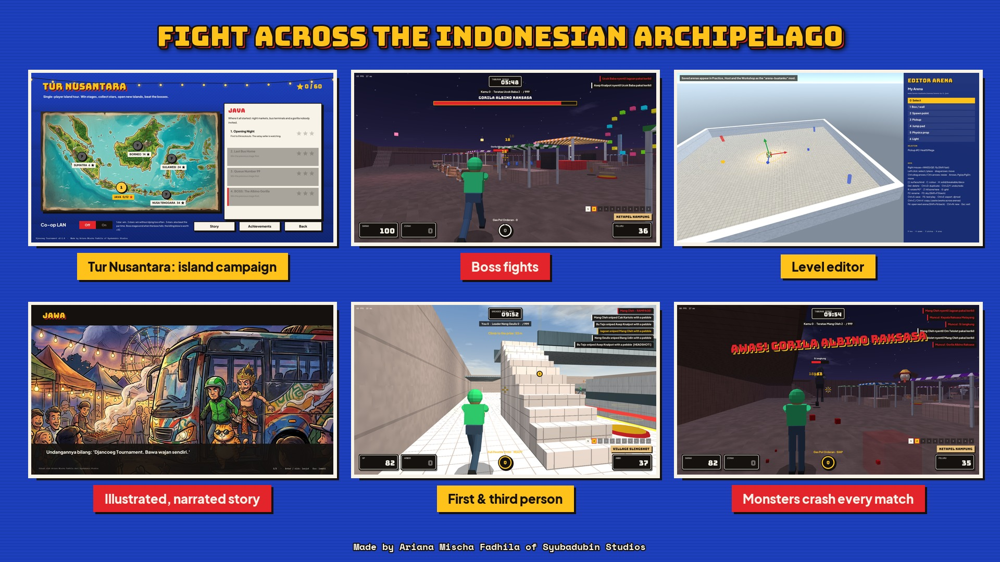
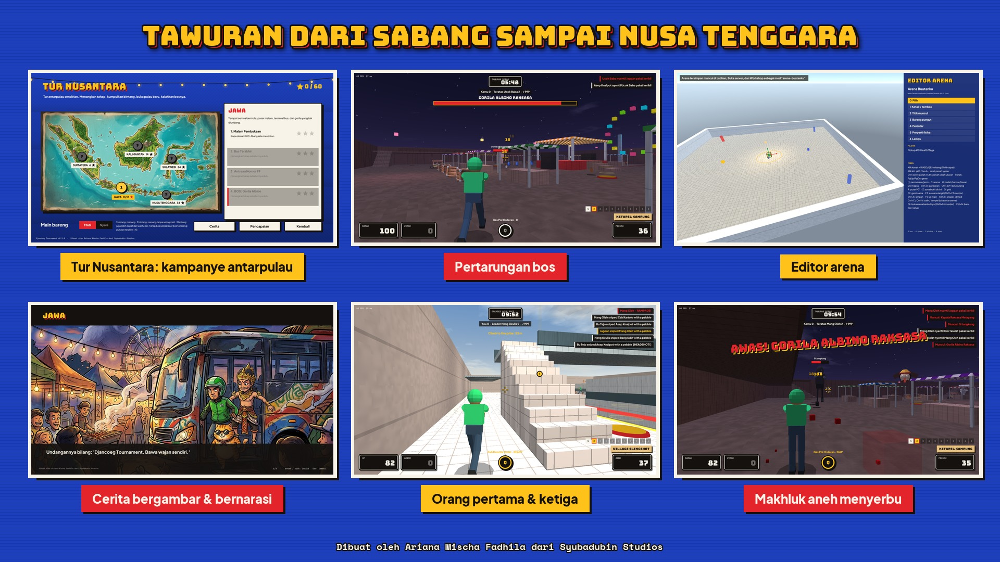

# Press kit / Kit promosi

**Dibuat oleh Ariana Mischa Fadhila dari Syubadubin Studios** · *Made by Ariana Mischa Fadhila of Syubadubin Studios*

[English](#english) · [Bahasa Indonesia](#bahasa-indonesia)

---

## English

### Fact sheet

| | |
|---|---|
| **Title** | Djancoeg Tournament — Ultimate Indonesian Chaos Battle Arena |
| **Developer** | Ariana Mischa Fadhila, Syubadubin Studios |
| **Platforms** | Windows 10/11, Linux (AppImage, .deb, Flatpak), macOS 12+ (Apple Silicon and Intel) |
| **Price** | Free |
| **Languages** | English, Bahasa Indonesia |
| **Download** | <https://github.com/SyubadubinStudios/DjancoegTournament/releases/latest> |

**Short description (≈ 150 characters)**
> A chaotic Indonesian arena shooter: wayang heroes, ride-hailing drivers, ghosts and an orange cat brawl across the archipelago. Solo, co-op or online.

**Long description**
> Djancoeg Tournament is a first- and third-person multiplayer arena shooter set in the night markets, bus terminals, rice fields and harbours of Indonesia. Pick from 17 fighters drawn from folk legends, everyday professions, ghost stories and memes. Each fighter has a signature ability, and the weapons run from a slingshot to a satay fan that blows rockets back at their owner.
>
> Tour five islands in the *Tur Nusantara* campaign: 20 stages, three stars each, and six boss fights. They include an albino gorilla, a one-eyed strongman and Buto Ijo rising from the sea, and each island opens with an illustrated, narrated story. Play it alone or in co-op over LAN or online.
>
> In every match, absurd Arena Creeps crash the fight. Stalls break apart piece by piece, and fallen fighters tumble as ragdolls. Build your own arenas in the level editor, share them through the Workshop, or host a 32-player server.

**Key features**
- 20-stage island campaign with 6 bosses, illustrated and narrated story, LAN/online co-op
- 17 fighters, 10 weapons, 7 arenas, 5 modes (free-for-all, team, king of the hill, capture the snack, rooftop race)
- First *and* third person, gamepad support, accessibility options
- Arena Creeps, destructible stalls, per-limb ragdolls, blood or confetti
- Level editor with gizmos, multi-select and Workshop upload; JSON mods
- Up to 32 players, encrypted connections, dedicated server, master server with NAT punch-through

### Assets

| File | Size | Use |
|---|---|---|
| [`banner-1920x820-en.jpg`](banner-1920x820-en.jpg) / [`-id`](banner-1920x820-id.jpg) | 1920×820 | Website/README header, X/Twitter header, itch.io banner |
| [`social-1080-en.jpg`](social-1080-en.jpg) / [`-id`](social-1080-id.jpg) | 1080×1080 | Instagram / Facebook post |
| [`story-1080x1920-en.jpg`](story-1080x1920-en.jpg) / [`-id`](story-1080x1920-id.jpg) | 1080×1920 | Instagram/Facebook stories, TikTok, Reels, Shorts |
| [`features-1920x1080-en.jpg`](features-1920x1080-en.jpg) / [`-id`](features-1920x1080-id.jpg) | 1920×1080 | Feature overview from real in-game screenshots |
| [`logo-transparent-1280x720.png`](logo-transparent-1280x720.png) | 1280×720 | Wordmark on transparent background (video end cards, overlays) |
| [`steam/`](steam/) | Steam sizes | Header 460×215, main 616×353, small 231×87, library 600×900, library hero 3840×1240 (no text, per Steam rules), library logo 1280×720 |
| [`art/`](art/) | Various | Text-free key art (wide, square, vertical, library) for your own layouts |

In-game screenshots are in [`../screenshots/`](../screenshots/).

**Usage:** press, streamers and fans may use these images to write about, stream or promote the game. Please don't alter the characters or imply an endorsement, and keep the credit line visible where there is room. Rebuild the lettered images with `python tools/marketing/make_marketing.py`. The key art was made with Rodin (Nano Banana 2), and the lettering uses the game's fonts (Bungee, Plus Jakarta Sans and Space Mono, all under the SIL Open Font License).

---

## Bahasa Indonesia

### Lembar fakta

| | |
|---|---|
| **Judul** | Djancoeg Tournament — Arena tawuran paling rusuh se-Nusantara |
| **Pengembang** | Ariana Mischa Fadhila, Syubadubin Studios |
| **Platform** | Windows 10/11, Linux (AppImage, .deb, Flatpak), macOS 12+ (Apple Silicon dan Intel) |
| **Harga** | Gratis |
| **Bahasa** | Inggris, Bahasa Indonesia |
| **Unduh** | <https://github.com/SyubadubinStudios/DjancoegTournament/releases/latest> |

**Deskripsi singkat**
> Game tembak-tembakan arena paling rusuh se-Nusantara: ksatria wayang, tukang ojol, pocong, dan kucing oren tawuran antarpulau. Main sendiri, bareng, atau online.

**Deskripsi panjang**
> Djancoeg Tournament adalah game tembak-tembakan arena multipemain dengan kamera orang pertama dan ketiga, berlatar pasar malam, terminal bus, sawah, dan pelabuhan Indonesia. Pilih satu dari 17 jagoan yang diambil dari legenda rakyat, profesi sehari-hari, cerita hantu, dan meme. Setiap jagoan punya jurus andalan, dan senjatanya beragam, dari ketapel sampai kipas sate yang memantulkan roket ke pemiliknya.
>
> Jelajahi lima pulau dalam kampanye *Tur Nusantara*: 20 tahap, tiga bintang per tahap, dan enam pertarungan bos. Lawannya antara lain gorila albino, cyclops kekar, dan Buto Ijo yang muncul dari laut, dan setiap pulau dibuka dengan cerita bergambar yang dibacakan. Mainkan sendiri atau bareng teman lewat LAN maupun online.
>
> Di setiap pertandingan, Makhluk Arena yang absurd ikut menyerbu. Lapak hancur sepotong demi sepotong, dan jagoan yang tumbang terguling sebagai ragdoll. Bikin arena sendiri di editor, bagikan lewat Workshop, atau buka server untuk 32 pemain.

**Fitur utama**
- Kampanye 20 tahap antarpulau dengan 6 bos, cerita bergambar dan bernarasi, main bareng LAN/online
- 17 jagoan, 10 senjata, 7 arena, 5 mode (tawuran bebas, perang kampung, raja warung, rebutan gorengan, panjat pinang)
- Kamera orang pertama *dan* ketiga, dukungan gamepad, opsi aksesibilitas
- Makhluk Arena, lapak yang bisa hancur, ragdoll per anggota tubuh, darah atau konfeti
- Editor arena dengan gizmo, pilih banyak, dan unggah ke Workshop; mod JSON
- Sampai 32 pemain, koneksi terenkripsi, dedicated server, master server dengan NAT punch-through

### Aset

| Berkas | Ukuran | Kegunaan |
|---|---|---|
| [`banner-1920x820-id.jpg`](banner-1920x820-id.jpg) / [`-en`](banner-1920x820-en.jpg) | 1920×820 | Header situs/README, header X/Twitter, banner itch.io |
| [`social-1080-id.jpg`](social-1080-id.jpg) / [`-en`](social-1080-en.jpg) | 1080×1080 | Postingan Instagram / Facebook |
| [`story-1080x1920-id.jpg`](story-1080x1920-id.jpg) / [`-en`](story-1080x1920-en.jpg) | 1080×1920 | Story Instagram/Facebook, TikTok, Reels, Shorts |
| [`features-1920x1080-id.jpg`](features-1920x1080-id.jpg) / [`-en`](features-1920x1080-en.jpg) | 1920×1080 | Ringkasan fitur dari screenshot asli dalam game |
| [`logo-transparent-1280x720.png`](logo-transparent-1280x720.png) | 1280×720 | Logo tulisan berlatar transparan (penutup video, overlay) |
| [`steam/`](steam/) | Ukuran Steam | Header 460×215, utama 616×353, kecil 231×87, library 600×900, library hero 3840×1240 (tanpa teks, sesuai aturan Steam), logo library 1280×720 |
| [`art/`](art/) | Beragam | Gambar utama tanpa teks (lebar, persegi, vertikal, library) untuk tata letak sendiri |

Screenshot dalam game ada di [`../screenshots/`](../screenshots/).

**Penggunaan:** media, streamer, dan penggemar boleh memakai gambar-gambar ini untuk menulis, siaran, atau mempromosikan game. Mohon jangan mengubah karakternya atau mengesankan adanya dukungan resmi, dan cantumkan baris kredit bila ada tempat. Buat ulang gambar bertulisan dengan `python tools/marketing/make_marketing.py`. Gambar utama dibuat dengan Rodin (Nano Banana 2), dan tulisannya memakai font game (Bungee, Plus Jakarta Sans, dan Space Mono, semuanya berlisensi SIL Open Font License).

